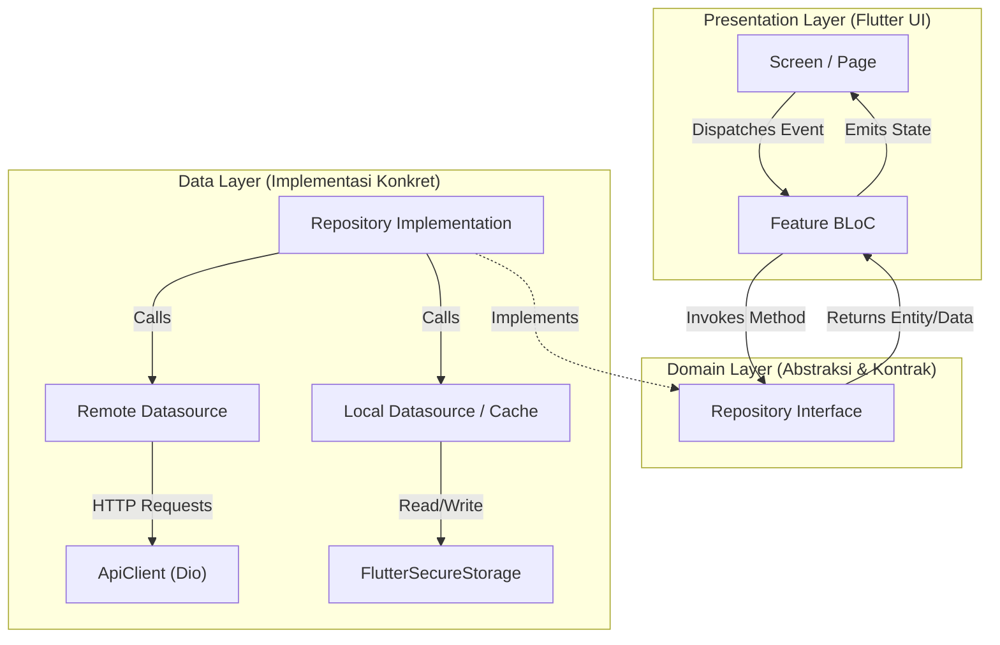
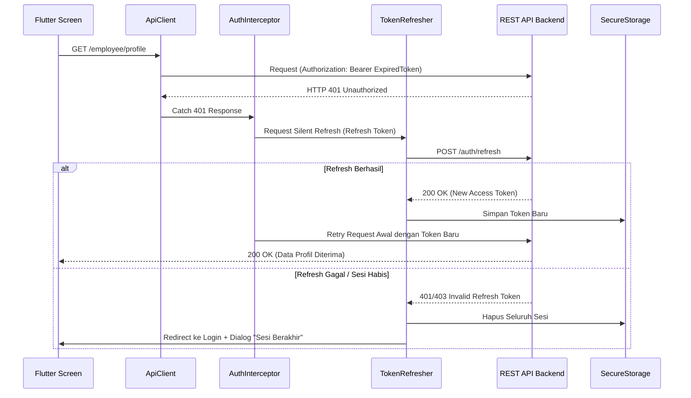
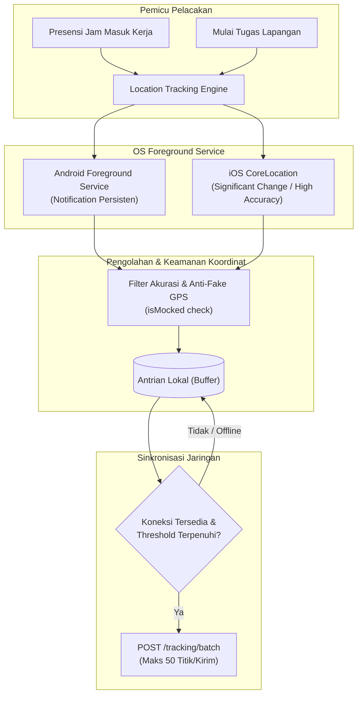

# Arsitektur Sistem — OASISH HRIS Mobile App (Flutter)

> **Cakupan**: arsitektur teknis aplikasi mobile, Feature-First Clean Architecture, state management BLoC (`flutter_bloc`), routing deklaratif `go_router`, siklus jaringan Dio & interceptor, persistensi `FlutterSecureStorage`, Design System Stitch M3 *Teal Oasis*, mesin background location tracking, serta integrasi FCM dan ML Kit Face Detection.
> **Terakhir diverifikasi terhadap kode**: Oktober 2026 (`lib/features/*`, `lib/core/*`, `lib/app/*`).

---

## Daftar Isi

1. [Filosofi Arsitektur & Struktur Folder](#1-filosofi-arsitektur--struktur-folder)
2. [State Management: BLoC Pattern (`flutter_bloc`)](#2-state-management-bloc-pattern-flutter_bloc)
3. [Lapisan Jaringan & HTTP Client (`Dio`)](#3-lapisan-jaringan--http-client-dio)
   - 3.1 [Arsitektur `ApiClient` & `ApiException`](#31-arsitektur-apiclient--apiexception)
   - 3.2 [Siklus Token, Silent Refresh & 401 Interceptor](#32-siklus-token-silent-refresh--401-interceptor)
   - 3.3 [HTTP Inspection & Debugging (`Alice`)](#33-http-inspection--debugging-alice)
4. [Persistensi & Keamanan Lokal (`FlutterSecureStorage`)](#4-persistensi--keamanan-lokal-fluttersecurestorage)
5. [Routing & Navigasi Deklaratif (`go_router`)](#5-routing--navigasi-deklaratif-go_router)
6. [Design System & UI Tokens (Stitch M3 "Teal Oasis")](#6-design-system--ui-tokens-stitch-m3-teal-oasis)
7. [Komponen Standar Global & Konsistensi UI](#7-komponen-standar-global--konsistensi-ui)
8. [Arsitektur Layanan Latar Belakang (Background Location Tracking)](#8-arsitektur-layanan-latar-belakang-background-location-tracking)
9. [Sistem Notifikasi & Deep Linking (Firebase FCM)](#9-sistem-notifikasi--deep-linking-firebase-fcm)
10. [Integrasi AI & Biometrik Kamera (Google ML Kit)](#10-integrasi-ai--biometrik-kamera-google-ml-kit)

---

## 1. Filosofi Arsitektur & Struktur Folder

Aplikasi mobile **OASISH HRIS** dibangun menggunakan perpaduan **Feature-First Organization** dan **Clean Architecture Layering**. Struktur ini memastikan isolasi domain antar modul, skalabilitas tinggi, kemudahan pengujian unit (testability), dan pemisahan tanggung jawab (*Separation of Concerns*).

```
lib/
├── app/                  # Konfigurasi dasar tingkat aplikasi
│   ├── config/           # Tema, palet warna, tipografi, dependency providers
│   └── routes/           # go_router declarative routing & route constants
├── core/                 # Komponen dan utilitas bersama lintas modul
│   ├── constants/        # API endpoints, app constants, permissions catalog
│   ├── localization/     # Konfigurasi bahasa (i18n)
│   ├── network/          # Dio client, interceptors, token refresher, ApiException
│   ├── services/         # Geolocator, permission, local notification, Alice inspector
│   ├── storage/          # FlutterSecureStorage wrapper & service
│   ├── theme/            # Theme helpers & styling definitions
│   ├── utils/            # Formatters (Rupiah, tanggal), dialog utils, file helpers
│   └── widgets/          # Global widgets (AppButton, AppTextField, EmployeeInfoRow, dll)
├── features/             # 17 Modul Domain Bisnis (Feature-First)
│   ├── [feature_name]/
│   │   ├── data/         # Models (DTO), Datasources (Remote/Local), Repositories Impl
│   │   ├── domain/       # Entities, Repository Interfaces, Value Objects
│   │   └── presentation/ # BLoC (Events & States), Pages (Screens), Local Widgets
├── gen/                  # Asset generators (flutter_gen)
├── l10n/                 # Localization ARB files (id & en)
└── main.dart             # Application bootstrap & dependency injection root
```

### Diagram Aliran Data Clean Architecture



---

## 2. State Management: BLoC Pattern (`flutter_bloc`)

Sesuai aturan arsitektur project, seluruh status reaktif dan logika bisnis dikelola secara eksklusif menggunakan **`flutter_bloc`** dan **`equatable`**. Dilarang menggunakan `setState` untuk panggilan jaringan atau operasi asinkron.

### Karakteristik Implementasi BLoC:
1. **Immutability dengan `Equatable`**: Setiap `State` dan `Event` memperluas kelas `Equatable` untuk memastikan evaluasi kesetaraan nilai (*value equality*), mencegah render ulang yang tidak perlu (*unnecessary rebuilds*).
2. **Event Transformers**: Untuk aksi pencarian (*search*) atau pemfilteran dinamis, BLoC menggunakan transformer `debounce` (durasi 300–500ms via `package:stream_transform`) untuk mencegah lonjakan pemanggilan API beruntun (*spamming*).
3. **Pemisahan Status Standar**:
   - `[Feature]Initial`: Status awal saat BLoC pertama kali diinstansiasi.
   - `[Feature]Loading`: Menampilkan indikator loading (Shimmer Skeleton pada list, CircularProgressIndicator pada tombol).
   - `[Feature]Loaded` / `Success`: Membawa data entitas untuk dirender di layar.
   - `[Feature]Failure`: Membawa kode status HTTP dan pesan kesalahan terlokalisasi dari backend.

---

## 3. Lapisan Jaringan & HTTP Client (`Dio`)

### 3.1 Arsitektur `ApiClient` & `ApiException`

Semua pertukaran data RESTful API dikelola oleh kelas singleton **`ApiClient`** (`lib/core/network/api_client.dart`) yang membungkus instans `Dio`:

- **Timeout Standar**:
  - `connectTimeout`: 15 detik.
  - `receiveTimeout`: 15 detik.
  - `sendTimeout`: 15 detik (diperpanjang otomatis saat mengunggah foto selfie atau berkas PDF).
- **Transformasi Error Terpusat (`ApiException`)**:
  Setiap kegagalan jaringan (DioException) dicegat dan dipetakan ke dalam objek `ApiException`:
  ```dart
  class ApiException implements Exception {
    final String message;
    final int? statusCode;
    final String? errorCode;
    final dynamic details;
  }
  ```
  Pesan kesalahan **selalu diekstrak langsung dari payload API backend** (`response.data['message']`), karena server telah menyesuaikan bahasa secara otomatis berdasarkan profil karyawan pengguna.

### 3.2 Siklus Token, Silent Refresh & 401 Interceptor

Aplikasi mengimplementasikan alur pembaruan token transparan (*Silent Token Refresh*) di [`lib/core/network/token_refresher.dart`](file:///Users/rafliandreansyah/Documents/Dev/muratech-hris/hris_flutter/lib/core/network/token_refresher.dart):



### 3.3 HTTP Inspection & Debugging (`Alice`)

Pada mode pengujian dan debug, aplikasi menyertakan **`Alice`** HTTP Inspector (`lib/core/network/alice_service.dart`). Pengembang dan tim QA dapat menggoyangkan perangkat (*shake*) atau membuka notifikasi Alice untuk menginspeksi:
- URL request, query params, dan request headers.
- Request payload JSON atau Multipart form data.
- Response body, response headers, dan durasi latensi jaringan (ms).

---

## 4. Persistensi & Keamanan Lokal (`FlutterSecureStorage`)

Data sensitif disimpan menggunakan enkripsi perangkat keras melalui **`FlutterSecureStorage`** (`lib/core/storage/`):
- **iOS**: Disimpan di **Apple Keychain** dengan atribut `kSecAccessControlBiometryAny` atau `kSecAttrAccessibleAfterFirstUnlock`.
- **Android**: Menggunakan **Android Keystore System** dan **EncryptedSharedPreferences** dengan algoritma AES-256 GCM.

### Item yang Disimpan:
1. `muratech_access_token`: Kunci JWT autentikasi aktif.
2. `muratech_refresh_token`: Kunci JWT perpanjangan sesi.
3. `muratech_user_profile`: Ringkasan profil JSON (nama, NIK, peran, perusahaan, avatar).
4. `muratech_user_permissions`: Set izin fungsional (`Set<String>`) untuk evaluasi hak akses instan di memori (`hasPermissionInMemory`).
5. `muratech_user_language`: Pilihan bahasa pengguna (`id` / `en`).

---

## 5. Routing & Navigasi Deklaratif (`go_router`)

Navigasi seluruh layar aplikasi menggunakan pustaka **`go_router`** (`lib/app/routes/app_router.dart`):

1. **Konstanta Rute Terpusat**: Seluruh nama dan path rute dideklarasikan di [`lib/app/routes/route_name.dart`](file:///Users/rafliandreansyah/Documents/Dev/muratech-hris/hris_flutter/lib/app/routes/route_name.dart).
2. **Redirect Guard (Auth Guard)**:
   Router memeriksa status autentikasi sebelum memuat halaman:
   - Jika pengguna belum terautentikasi dan mencoba mengakses rute internal (misal: `/dashboard` atau `/attendance`), router langsung mengalihkan rute ke `/login`.
   - Jika pengguna sudah terautentikasi dan membuka layar `/login`, router otomatis mengalihkan ke `/dashboard`.
3. **Deep Linking Support**: Terintegrasi dengan notifikasi push FCM untuk membuka layar detail transaksi spesifik secara langsung berdasarkan parameter path (`/leave/detail/:id`, `/attendance-request/detail/:id`).

---

## 6. Design System & UI Tokens (Stitch M3 "Teal Oasis")

Seluruh elemen visual aplikasi mengacu pada **Google Stitch M3 "Teal Oasis" Design System** (Project ID: `17152850901645837896`).

> [!IMPORTANT]
> **Zero Hardcoded Values**: Dilarang keras menuliskan nilai warna (`Color(0xFF...)`), padding, margin, border radius, atau TextStyle manual secara langsung di widget. Selalu gunakan token desain:

| Kategori Token | File Lokasi | Contoh Penggunaan |
|---|---|---|
| **Warna (Colors)** | `lib/app/config/app_colors.dart` | `AppColors.brandTeal`, `AppColors.primary`, `AppColors.surface`, `AppColors.error` |
| **Tipografi** | `lib/app/config/app_typography.dart` | `AppTypography.titleLarge`, `AppTypography.bodyMedium`, `AppTypography.labelSmall` |
| **Spasi & Margin** | `lib/app/config/app_design.dart` | `AppSpacing.xs` (4), `AppSpacing.sm` (8), `AppSpacing.md` (16), `AppSpacing.lg` (24) |
| **Border Radius** | `lib/app/config/app_design.dart` | `AppRadius.sm` (8), `AppRadius.md` (12), `AppRadius.lg` (16), `AppRadius.pill` (999) |
| **Ikon** | `package:lucide_icons_flutter` | `LucideIcons.calendarClock`, `LucideIcons.mapPin`, `LucideIcons.users` |

---

## 7. Komponen Standar Global & Konsistensi UI

Untuk mencegah inkonsistensi antarmuka antar modul, aplikasi mewajibkan penggunaan widget global terstandarisasi di `lib/core/widgets/`:

1. **`AppButton` (`lib/core/widgets/app_button.dart`)**:
   - Seluruh tombol aksi (Submit, Setujui, Tolak, Simpan) wajib menggunakan `AppButton`.
   - Memiliki parameter terintegrasi `isLoading: isSubmitting` yang otomatis merender `CircularProgressIndicator` centered dan menonaktifkan ketukan ganda (*double-tap prevention*).
2. **`EmployeeInfoRow` (`lib/core/widgets/employee_info_row.dart`)**:
   - Komponen standar tunggal untuk merender identitas karyawan (avatar bulat, nama lengkap, jabatan • departemen, NIK badge, dan badge nama perusahaan).
   - Digunakan di seluruh kartu list request dan card **`INFORMASI PENGAJU`** / **`PEJABAT PENYETUJU`**.
3. **`AppRequestFilterBottomSheet` (`lib/core/widgets/filter/`)**:
   - Komponen modular filter terpadu untuk seluruh modul pengajuan (Cuti, Lembur, Koreksi Absensi, Klaim).
   - Mengintegrasikan cascading filter organisasi (Perusahaan -> Departemen -> Posisi), selector status segmented chip, dan date range picker.
4. **`AppSearchBar` (`lib/core/widgets/app_search_bar.dart`)**:
   - Search bar terpadu dengan card background bersih, ikon pencarian, tombol clear (`x`), dan otomatis unfocus keyboard saat luar area diketuk (`onTapOutside`).
5. **`AppDialogUtil` (`package:pro_dialog`)**:
   - Seluruh alert, konfirmasi hapus, popup sukses, dan dialog izin perangkat wajib menggunakan `AppDialogUtil`. Dilarang menggunakan raw `AlertDialog` atau `SnackBar`.

---

## 8. Arsitektur Layanan Latar Belakang (Background Location Tracking)

Modul pelacakan lokasi dirancang dengan ketahanan tinggi terhadap pembatasan daya (*battery optimization*) sistem operasi:



Detail teknis lengkap: [LOCATION_TRACKING.md](./LOCATION_TRACKING.md).

---

## 9. Sistem Notifikasi & Deep Linking (Firebase FCM)

1. **Inisialisasi & Registrasi Token**:
   Saat login berhasil, `NotificationService` meminta izin notifikasi (`POST_NOTIFICATIONS`) dan mengambil FCM Device Registration Token, lalu mengirimkannya ke server backend via `POST /employee/fcm-token`.
2. **Penanganan Pesan Latar Depan & Belakang**:
   - *Foreground*: Notifikasi ditampilkan sebagai pop-up banner lokal menggunakan `flutter_local_notifications`.
   - *Background & Terminated*: Notifikasi ditangani oleh handler `firebaseMessagingBackgroundHandler`.
3. **Navigasi Deep Link**:
   Ketika notifikasi diketuk, `NotificationClickActionDispatcher` membaca payload `route` dan `id`, lalu mengarahkan `GoRouter` langsung ke layar detail yang relevan.
   Detail teknis payload: [NOTIFICATION_CLICK_ACTION_SPEC.md](./NOTIFICATION_CLICK_ACTION_SPEC.md).

---

## 10. Integrasi AI & Biometrik Kamera (Google ML Kit)

1. **Deteksi Wajah di Perangkat (`google_mlkit_face_detection`)**:
   - Sebelum foto presensi dikirim ke server, Google ML Kit memeriksa apakah wajah pengguna terdeteksi jelas di dalam bingkai oval panduan.
   - Memvalidasi sudut rotasi kepala (Euler Y & Z) agar wajah menghadap lurus ke depan, serta mengevaluasi status mata terbuka.
2. **Otentikasi Perangkat Keras (`local_auth`)**:
   - Digunakan saat login cepat atau membuka fitur rahasia (Slip Gaji).
   - Mendukung Android BiometricPrompt (Fingerprint & Face) dan Apple LocalAuthentication (Touch ID & Face ID).

---

> Dokumen terkait:
> - Panduan deploy dan rilis toko aplikasi: [DEPLOYMENT.md](./DEPLOYMENT.md)
> - Panduan memulai bagi developer: [ONBOARDING.md](./ONBOARDING.md)
> - Penjelasan fitur & domain bisnis: [FEATURES.md](./FEATURES.md)
> - Hak akses dan katalog permission: [AUTHORIZATION.md](./AUTHORIZATION.md)
