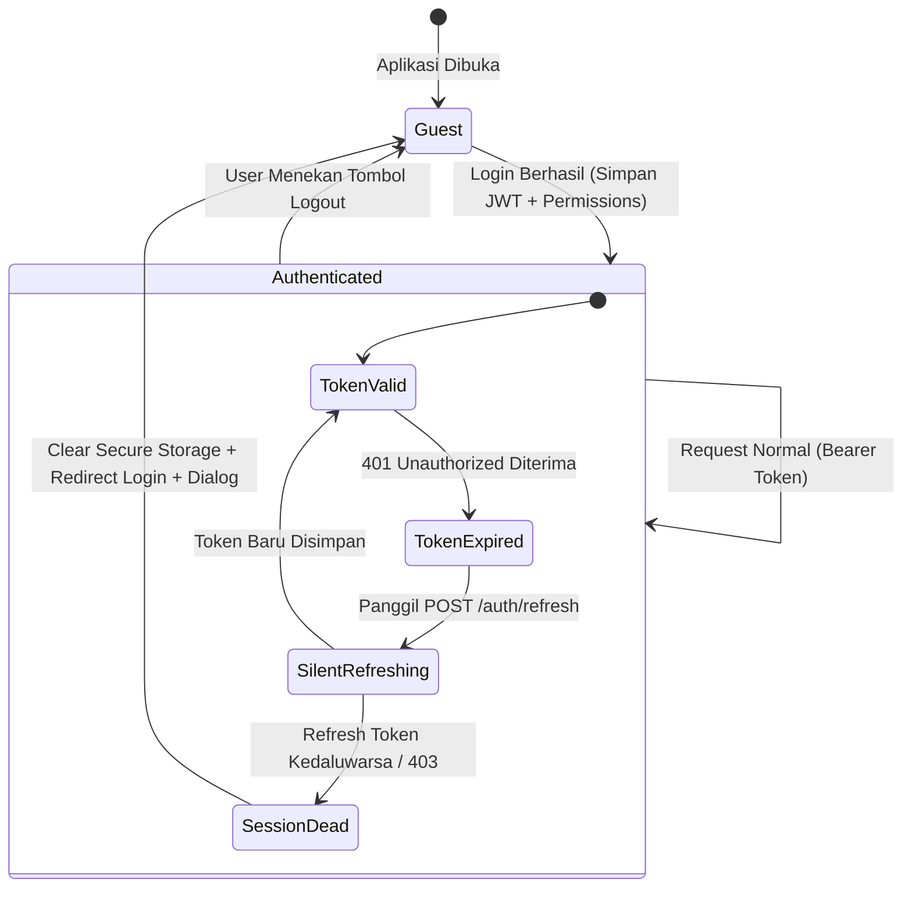

# Otorisasi, Hak Akses & Katalog Permission — OASISH HRIS Mobile App (Flutter)

> **Cakupan**: arsitektur otorisasi multi-layer di aplikasi mobile, mekanisme visibilitas menu Bento Grid (`GET /auth/menus`), pengecekan izin fungsional (`hasPermissionInMemory`), manajemen token JWT (Access Token, Refresh Token, Silent Refresh, Auto-Logout), penanganan error `403 Forbidden`, dan katalog pemetaan lengkap permission antara REST API (`muratech_hris_server`) dan mobile (`hris_flutter`).
> **Terakhir diverifikasi terhadap kode**: Oktober 2026 (`lib/core/storage/`, `lib/core/constants/app_permissions.dart`, `lib/core/network/`).

---

## Daftar Isi

1. [Arsitektur Otorisasi Tiga Lapis (Defense in Depth)](#1-arsitektur-otorisasi-tiga-lapis-defense-in-depth)
2. [Lapisan 1: Visibilitas Menu Bento Grid (`GET /auth/menus`)](#2-lapisan-1-visibilitas-menu-bento-grid-get-authmenus)
3. [Lapisan 2: Hak Aksi & Permission Fungsional (`GET /auth/profile`)](#3-lapisan-2-hak-aksi--permission-fungsional-get-authprofile)
4. [Lapisan 3: Penegakan Batasan Data di Backend (Data Scope Guard)](#4-lapisan-3-penegakan-batasan-data-di-backend-data-scope-guard)
5. [Siklus Sesi, Penyimpanan Aman & Auto-Logout](#5-siklus-sesi-penyimpanan-aman--auto-logout)
6. [Standar Penanganan Error 403 Forbidden](#6-standar-penanganan-error-403-forbidden)
7. [Matriks Katalog Permission Lengkap (API vs Mobile)](#7-matriks-katalog-permission-lengkap-api-vs-mobile)

---

## 1. Arsitektur Otorisasi Tiga Lapis (Defense in Depth)

Sistem OASISH HRIS menerapkan strategi keamanan pertahanan berlapis (*Defense in Depth*) yang menyelaraskan antarmuka mobile dengan aturan akses backend:

```
┌────────────────────────────────────────────────────────────────────────┐
│                        3 LAPISAN OTORISASI HRIS                        │
├──────────────────┬───────────────────────┬─────────────────────────────┤
│ 1. MENU ACCESS   │ 2. FUNCTIONAL PERMS   │ 3. DATA SCOPE               │
│ (Navigasi Modul) │ (Wewenang Aksi/Fitur) │ (Batasan Baris Data di DB)  │
├──────────────────┼───────────────────────┼─────────────────────────────┤
│ • GET /auth/menus│ • GET /auth/profile   │ • Prisma Scoped Query       │
│ • Menentukan     │ • Menentukan tombol   │ • Menentukan data bawahan,  │
│   modul mana     │   Setujui, Tolak,     │   satu divisi, satu cabang, │
│   yang tampil di │   Cairkan Dana, dsb.  │   atau lintas perusahaan.   │
│   Bento Grid     │ • Evaluasi O(1) via   │ • Diinjeksi otomatis via    │
│   Dashboard.     │   In-Memory Cache.    │   getScopedEmployeeWhere.   │
└──────────────────┴───────────────────────┴─────────────────────────────┘
```

### Prinsip Keamanan & User Experience:
1. **API adalah Security Boundary Mutlak**:
   - Jika pengguna tidak memiliki wewenang yang dipersyaratkan, Backend API wajib menolak permintaan dengan **HTTP 403 Forbidden**.
2. **Mobile App Mengadaptasi UX (Adaptive UX)**:
   - **Hide Action Button**: Tombol *Setujui*, *Tolak*, *Cairkan Dana*, atau *Terbitkan SP* disembunyikan jika izin tidak ada di memori.
   - **Context-Aware Tabs**: Pengguna tanpa hak akses approver diarahkan langsung ke tampilan data pribadi tanpa menampilkan tab persetujuan tim yang kosong atau memicu 403.
   - **Smart Navigation**: Klik menu pada Dashboard (misal: "Jadwal Kerja") mengarahkan langsung ke jadwal kerja pribadi user (`RouteName.workSchedule`), bukan ke halaman seleksi rekan kerja yang berisiko memicu 403.

---

## 2. Lapisan 1: Visibilitas Menu Bento Grid (`GET /auth/menus`)

Menu pada Dashboard utama menggunakan Bento Grid modular yang merender ikon secara dinamis sesuai respons endpoint `GET /auth/menus`.

### Alur Kerja di Flutter:
1. `DashboardBloc` mengeksekusi `_dashboardRepository.getMenus()`.
2. Endpoint `GET /auth/menus` mengembalikan daftar menu yang aktif untuk perusahaan dan karyawan tersebut.
3. State `DashboardLoaded` menyimpan daftar menu (`state.menus`).
4. Komponen `QuickAccessGrid` (`lib/features/dashboard/presentation/widgets/quick_access_grid.dart`) menyaring menu yang ditampilkan via utilitas `isMenuAvailable`:
   ```dart
   final displayMenus = (menus != null && menus!.isNotEmpty)
       ? _defaultMenus.where((item) => isMenuAvailable(item.code, item.title, menus)).toList()
       : _defaultMenus;
   ```
5. Jika suatu menu dinonaktifkan oleh kebijakan perusahaan (misal: fitur *Kasbon* atau *Surat Peringatan* ditiadakan), item tersebut **langsung hilang** dari grid secara mulus tanpa merusak proporsi tata letak (*responsive auto-layout*).

### Tabel Pemetaan 12 Menu Quick Access Dashboard:

| No | Label Menu | Kode Menu API | Rute Tujuan Mobile (`RouteName`) |
|---|---|---|---|
| 1 | Presensi | `attendance` | `RouteName.attendance` |
| 2 | Koreksi Absen | `attendance_request` | `RouteName.attendanceRequest` |
| 3 | Aktivitas | `activity` | `RouteName.activity` |
| 4 | Cuti & Izin | `leave` | `RouteName.leave` |
| 5 | Lembur | `overtime` | `RouteName.overtime` |
| 6 | Klaim Biaya | `reimbursement` | `RouteName.reimbursement` |
| 7 | Kasbon | `cash_advance` | `RouteName.cashAdvance` |
| 8 | Slip Gaji | `payroll` | `RouteName.payroll` |
| 9 | Jadwal Kerja | `work_schedule` | `RouteName.workSchedule` |
| 10| Rekan Kerja | `employee` | `RouteName.employeeDirectory` |
| 11| Aset Kantor | `asset` | `RouteName.myAssets` |
| 12| Surat Peringatan | `warning_letter` | `RouteName.warningLetter` |

---

## 3. Lapisan 2: Hak Aksi & Permission Fungsional (`GET /auth/profile`)

### Alur Penyimpanan:
Saat login berhasil atau aplikasi memuat profil pengguna (`GET /auth/profile`), `AuthRepositoryImpl` otomatis mengekstrak daftar permission dan menyimpannya ke `SecureStorageService`:

```dart
if (profile.permissions.isNotEmpty) {
  await SecureStorageService.instance.saveUserPermissions(profile.permissions);
}
```

### Cara Memeriksa Permission di Widget & BLoC:
`SecureStorageService` menyediakan metode evaluasi $O(1)$ cepat langsung dari cache memori tanpa perlu I/O disk asinkron:

```dart
// 1. Evaluasi instan langsung dari in-memory cache (sangat ideal untuk build widget):
final canApprove = SecureStorageService.instance.hasPermissionInMemory('approval.leave.action');

if (canApprove) {
  return AppButton(
    text: 'Setujui Pengajuan',
    onPressed: _handleApprove,
  );
}

// 2. Evaluasi asinkron dengan fallback ke disk penyimpanan aman:
final hasManage = await SecureStorageService.instance.hasPermission('activity.manage');
```

---

## 4. Lapisan 3: Penegakan Batasan Data di Backend (Data Scope Guard)

Meskipun pengguna memiliki hak akses fungsional (misal: dapat melihat log presensi), backend `muratech_hris_server` menerapkan pembatasan cakupan data (*Data Scoping*) berbasis relasi organisasi:
- `SELF`: Hanya data milik dirinya sendiri.
- `SUBORDINATE`: Data milik bawahan langsung berdasarkan struktur hierarki `reportsToId`.
- `DEPARTMENT`: Seluruh karyawan di departemen yang sama.
- `COMPANY`: Seluruh karyawan di perusahaan yang sama.
- `ALL`: Seluruh holding / multi-company (khusus Super Admin).

Aplikasi mobile tidak perlu melakukan kalkulasi hierarki ini secara manual; backend secara otomatis memfilter query basis data dan mengembalikan data yang sah.

---

## 5. Siklus Sesi, Penyimpanan Aman & Auto-Logout



### Prosedur Auto-Logout Terpusat:
Jika refresh token ditolak oleh backend (HTTP 401/403):
1. `ApiClient` menghapus access token dan refresh token dari memori dan `FlutterSecureStorage`.
2. `NotificationService` membatalkan registrasi FCM token di backend.
3. `AppDialogUtil.showError` memunculkan pesan: *"Sesi Anda telah berakhir. Silakan masuk kembali."*
4. `GoRouter` mengarahkan pengguna kembali ke layar `RouteName.login` dan membersihkan riwayat tumpukan navigasi (*navigation stack*).

---

## 6. Standar Penanganan Error 403 Forbidden

Ketika seorang pengguna mencoba melakukan aksi yang hak wewenangnya telah dicabut (misal: menekan tombol approve lama sebelum refresh profile):
1. Backend mengembalikan status HTTP `403 Forbidden` dengan pesan localized dari server (contoh: *"Anda tidak memiliki wewenang untuk menyetujui pengajuan ini."*).
2. `ApiClient` menangkap respons dan melempar `ApiException`.
3. BLoC menangkap `ApiException` dan meneruskan status `state.failure(message: e.message)`.
4. Layar UI menampilkan dialog standar `AppDialogUtil.showError(context, message: state.message)`.
5. Dilarang keras menampilkan teks error berbahasa Inggris statis seperti *"Forbidden Access"* atau *"You don't have permission"*. Selalu gunakan `e.message` langsung dari server.

---

## 7. Matriks Katalog Permission Lengkap (API vs Mobile)

Konstanta resmi dikelola di:
- **Backend**: `src/core/constant/permissions.ts`
- **Mobile**: `lib/core/constants/app_permissions.dart`

### A. Modul Izin & Cuti (Leave)

| Kode Permission | Konstanta Backend | Konstanta Mobile | Endpoint Terkait | Fungsi di Mobile |
|---|---|---|---|---|
| `approval.leave.view` | `APPROVAL_LEAVE_VIEW` | `approvalLeaveView` | `GET /leave/approvals` | Mengaktifkan tab "Persetujuan Tim" di modul cuti |
| `approval.leave.action` | `APPROVAL_LEAVE_ACTION` | `approvalLeaveAction` | `POST /leave/:id/approve` | Menampilkan tombol **Setujui** & **Tolak** di `LeaveDetailPage` |
| `leave.manage` | `LEAVE_MANAGE` | `leaveManage` | `POST /leave/request` | Mengizinkan pengajuan cuti langsung |
| `leave_balance.view` | `LEAVE_BALANCE_VIEW` | `leaveBalanceView` | `GET /leave/balance` | Menampilkan ringkasan sisa saldo cuti |

### B. Modul Lembur (Overtime)

| Kode Permission | Konstanta Backend | Konstanta Mobile | Endpoint Terkait | Fungsi di Mobile |
|---|---|---|---|---|
| `approval.overtime.view` | `APPROVAL_OVERTIME_VIEW` | `approvalOvertimeView` | `GET /overtime/approvals` | Mengaktifkan tab "Persetujuan Tim" di lembur |
| `approval.overtime.action`| `APPROVAL_OVERTIME_ACTION`| `approvalOvertimeAction` | `POST /overtime/:id/approve` | Menampilkan tombol **Setujui** & **Tolak** di `OvertimeDetailPage` |
| `overtime.manage` | `OVERTIME_MANAGE` | `overtimeManage` | `POST /overtime/request` | Akses form pembuatan pengajuan lembur |

### C. Modul Presensi & Koreksi Kehadiran (Attendance)

| Kode Permission | Konstanta Backend | Konstanta Mobile | Endpoint Terkait | Fungsi di Mobile |
|---|---|---|---|---|
| `attendance.view` | `ATTENDANCE_VIEW` | `attendanceView` | `GET /attendance/history` | Melihat riwayat presensi harian |
| `attendance.manage` | `ATTENDANCE_MANAGE` | `attendanceManage` | `POST /attendance/clock-in` | Melakukan Clock In dan Clock Out mandiri |
| `approval.attendance.view` | `APPROVAL_ATTENDANCE_VIEW` | `approvalAttendanceView` | `GET /attendance-requests/approvals` | Mengaktifkan tab "Persetujuan Tim" koreksi presensi |
| `approval.attendance.action`| `APPROVAL_ATTENDANCE_ACTION`| `approvalAttendanceAction`| `POST /attendance-requests/:id/approve` | Menampilkan tombol **Setujui** / **Tolak** koreksi absensi |

### D. Modul Aktivitas Lapangan (Activity)

| Kode Permission | Konstanta Backend | Konstanta Mobile | Endpoint Terkait | Fungsi di Mobile |
|---|---|---|---|---|
| `activity.view` | `ACTIVITY_VIEW` | `activityView` | `GET /activity` | Melihat linimasa feed aktivitas lapangan |
| `activity.manage` | `ACTIVITY_MANAGE` | `activityManage` | `POST /activity` | Mengunggah foto bukti kegiatan lapangan baru |

### E. Modul Klaim Biaya & Kasbon (Reimbursement & Cash Advance)

| Kode Permission | Konstanta Backend | Konstanta Mobile | Endpoint Terkait | Fungsi di Mobile |
|---|---|---|---|---|
| `reimbursement.view` | `REIMBURSEMENT_VIEW` | `reimbursementView` | `GET /reimbursement/my` | Melihat riwayat klaim biaya mandiri |
| `reimbursement.create` | `REIMBURSEMENT_CREATE` | `reimbursementCreate` | `POST /reimbursement/request` | Form pengajuan klaim baru |
| `approval.reimbursement.view` | `APPROVAL_REIMBURSEMENT_VIEW` | `approvalReimbursementView` | `GET /reimbursement/approvals` | Tab persetujuan klaim bawahan |
| `approval.reimbursement.action`| `APPROVAL_REIMBURSEMENT_ACTION`| `approvalReimbursementAction`| `POST /reimbursement/:id/approve` | Tombol Setujui / Tolak klaim |
| `cash_advance.view` | `CASH_ADVANCE_VIEW` | `cashAdvanceView` | `GET /cash-advance/my` | Riwayat kasbon dinas |
| `cash_advance.create` | `CASH_ADVANCE_CREATE` | `cashAdvanceCreate` | `POST /cash-advance/request` | Form pengajuan kasbon |

### F. Modul Slip Gaji (Payroll)

| Kode Permission | Konstanta Backend | Konstanta Mobile | Endpoint Terkait | Fungsi di Mobile |
|---|---|---|---|---|
| `payroll.view` | `PAYROLL_VIEW` | `payrollView` | `GET /payroll/my-slips` | Mengakses menu dan riwayat slip gaji bulanan |
| `payroll.download` | `PAYROLL_DOWNLOAD` | `payrollDownload` | `GET /payroll/slip/:id` | Mengunduh dan membagikan berkas PDF slip gaji |

### G. Modul Disiplin (Warning Letter)

| Kode Permission | Konstanta Backend | Konstanta Mobile | Endpoint Terkait | Fungsi di Mobile |
|---|---|---|---|---|
| `warning_letter.view` | `WARNING_LETTER_VIEW` | `warningLetterView` | `GET /warning-letters` | Melihat riwayat surat peringatan yang diterima |
| `warning_letter.acknowledge` | `WARNING_LETTER_ACKNOWLEDGE` | `warningLetterAcknowledge` | `POST /warning-letters/:id/acknowledge` | Tombol konfirmasi tanda tangan/telah membaca SP |

---

> Dokumen terkait:
> - Penjelasan fitur aplikasi: [FEATURES.md](./FEATURES.md)
> - Arsitektur sistem: [ARCHITECTURE.md](./ARCHITECTURE.md)
> - Panduan rilis toko aplikasi: [DEPLOYMENT.md](./DEPLOYMENT.md)
