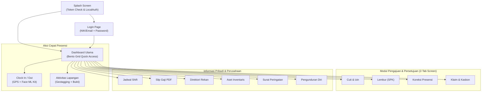

# Katalog Fitur — OASISH HRIS Mobile App (Flutter)

> **Cakupan**: penjelasan mendalam dan menyeluruh mengenai 17 domain fitur aplikasi mobile **OASISH HRIS (Oasish)** (`hris_flutter`). Setiap modul merinci komponen UI, arsitektur BLoC, aturan validasi bisnis, endpoint REST API yang dikonsumsi, serta interaksi perangkat mobile (Kamera, GPS Geofencing, Biometrik, dan Notifikasi).
> **Terakhir diverifikasi terhadap kode**: Oktober 2026 (`lib/features/*`, `lib/core/*`, `lib/app/*`).

---

## Daftar Isi

1. [Peta Modul & Navigasi Utama](#1-peta-modul--navigasi-utama)
2. [Modul 1: Splash & Otentikasi (`auth`, `splash`)](#2-modul-1-splash--otentikasi-auth-splash)
3. [Modul 2: Beranda & Dashboard Bento Grid (`dashboard`)](#3-modul-2-beranda--dashboard-bento-grid-dashboard)
4. [Modul 3: Presensi Harian & Verifikasi Wajah (`attendance`)](#4-modul-3-presensi-harian--verifikasi-wajah-attendance)
5. [Modul 4: Pengajuan Koreksi Presensi & Kehadiran Khusus (`attendance_request`)](#5-modul-4-pengajuan-koreksi-presensi--kehadiran-khusus-attendance_request)
6. [Modul 5: Pelaporan Aktivitas Lapangan & Geotagging (`activity`)](#6-modul-5-pelaporan-aktivitas-lapangan--geotagging-activity)
7. [Modul 6: Pelacakan Lokasi Latar Belakang (`tracking`)](#7-modul-6-pelacakan-lokasi-latar-belakang-tracking)
8. [Modul 7: Cuti & Izin Kerja (`leave`)](#8-modul-7-cuti--izin-kerja-leave)
9. [Modul 8: Pengajuan Lembur / Overtime (`overtime`)](#9-modul-8-pengajuan-lembur--overtime-overtime)
10. [Modul 9: Klaim Biaya & Kasbon Dinas (`reimbursement`)](#10-modul-9-klaim-biaya--kasbon-dinas-reimbursement)
11. [Modul 10: Slip Gaji Digital (`payroll`)](#11-modul-10-slip-gaji-digital-payroll)
12. [Modul 11: Jadwal Kerja & Shift (`schedule`)](#12-modul-11-jadwal-kerja--shift-schedule)
13. [Modul 12: Direktori Rekan & Profil Karyawan (`employee`)](#13-modul-12-direktori-rekan--profil-karyawan-employee)
14. [Modul 13: Siklus Hidup & Riwayat Karir (`lifecycle`)](#14-modul-13-siklus-hidup--riwayat-karir-lifecycle)
15. [Modul 14: Manajemen Aset & Inventaris (`asset`)](#15-modul-14-manajemen-aset--inventaris-asset)
16. [Modul 15: Surat Peringatan & Disiplin (`warning_letter`)](#16-modul-15-surat-peringatan--disiplin-warning_letter)
17. [Modul 16: Pengunduran Diri / Offboarding (`resignation`)](#17-modul-16-pengunduran-diri--offboarding-resignation)
18. [Modul 17: Pengumuman & Pusat Notifikasi (`announcement`, `notification`)](#18-modul-17-pengumuman--pusat-notifikasi-announcement-notification)

---

## 1. Peta Modul & Navigasi Utama

Aplikasi mobile dirancang dengan filosofi **Employee Self-Service (ESS) First**: mempermudah karyawan melakukan absensi, mengajukan permohonan kerja, dan memantau hak remunerasi dengan antarmuka Stitch M3 *Teal Oasis* yang modern, cepat, dan responsif.

---

## 2. Modul 1: Splash & Otentikasi (`auth`, `splash`)

### Komponen & Halaman
- **`SplashScreen`**: Memeriksa token JWT tersimpan di `FlutterSecureStorage`. Jika valid, memicu otentikasi biometrik lokal (*LocalAuth Fingerprint/Face ID*), lalu mengarahkan ke Dashboard. Jika sesi habis/kosong, mengarahkan ke Login.
- **`LoginPage`**: Masuk menggunakan NIK (Nomor Induk Karyawan) atau Email dan Password. Dilengkapi toggle intip password (*obscure toggle*) dan opsi "Ingat Saya" (*Remember Me*).
- **`ResetPasswordPage`**: Form pemulihan kata sandi melalui pengiriman instruksi email atau kontak HR.
- **`ChangePasswordBottomSheet`**: Dialog penggantian kata sandi dari profil (Kata Sandi Lama, Baru, dan Konfirmasi Baru dengan indikator kekuatan password).

### Logika Bisnis & Keamanan
1. **Header Telemetri Perangkat**: Setiap request login mengirim header perangkat (`x-device-id`, `x-platform`, `x-device-model`, `x-os-version`, `x-app-version`) untuk audit login akun.
2. **Penyimpanan Token Kriptografis**: Token akses (`muratech_access_token`) dan refresh token (`muratech_refresh_token`) disimpan di `FlutterSecureStorage` (menggunakan Keychain di iOS dan EncryptedSharedPreferences di Android).
3. **Penyimpanan Profil In-Memory**: Data profil karyawan, daftar menu Bento Grid yang diizinkan (`GET /auth/menus`), dan set permission fungsional disimpan di memory session untuk akses instan tanpa I/O berulang.

### Endpoint API Terkait
- `POST /auth/login`: Autentikasi NIK/Email dan Password.
- `POST /auth/refresh`: Memperbarui access token menggunakan refresh token.
- `GET /auth/profile`: Profil lengkap karyawan beserta daftar izin.
- `GET /auth/menus`: Daftar kode menu yang aktif untuk user.
- `POST /auth/logout`: Menghapus sesi dan mendaftarkan revokasi token di server.
- `POST /employee/update-password`: Memperbarui password mandiri.

---

## 3. Modul 2: Beranda & Dashboard Bento Grid (`dashboard`)

### Komponen & Halaman
- **Header Karyawan**: Menampilkan foto profil bulat (`AppAvatar`), nama lengkap, jabatan, nama cabang/perusahaan, dan tombol notifikasi lonceng dengan *unread badge count*.
- **Live Clock & Status Shift Banner**: Jam real-time detik berjalan, nama shift hari ini (contoh: *Shift Pagi: 08:00 - 17:00*), jam masuk actual, dan status kehadiran hari ini (*Belum Masuk*, *Tepat Waktu*, *Terlambat*, *Sudah Pulang*).
- **Quick Action Card (Clock In / Clock Out)**: Tombol aksi utama dengan visual gradient dan animasi denyut (*pulse*) saat mendekati batas jam masuk/pulang.
- **Bento Grid Quick Access (12 Menu)**: Grid modular responsif (2 baris x 4 kolom) yang menampilkan fitur-fitur utama.
- **Recent Activity Feed**: Ringkasan singkat 3 riwayat presensi atau tugas lapangan terakhir.

### Aturan Visibilitas Menu Bento Grid
Sesuai standar otorisasi dua lapis (lihat [AUTHORIZATION.md](./AUTHORIZATION.md)), setiap kotak menu di Bento Grid hanya akan ditampilkan jika kode menunya terdaftar di respon `GET /auth/menus`. Jika suatu menu dinonaktifkan oleh kebijakan perusahaan (misal: menu *Kasbon* atau *Surat Peringatan* ditiadakan), item tersebut lenyap secara mulus tanpa merusak proporsi grid.

---

## 4. Modul 3: Presensi Harian & Verifikasi Wajah (`attendance`)

### Komponen & Halaman
- **`AttendanceClockPage`**: Layar penuh interaktif yang memadukan:
  - **Pratinjau Kamera Langsung (`camera`)**: Kamera depan menghadap wajah karyawan.
  - **Deteksi Wajah Real-Time (`google_mlkit_face_detection`)**: Validasi keberadaan wajah manusia di dalam oval pemindai (memeriksa posisi tegak lurus, sudut rotasi kepala, dan pencahayaan).
  - **Peta Geofence Mini (`google_maps_flutter`)**: Menampilkan posisi GPS karyawan saat ini terhadap poligon/radius lokasi kantor yang sah.
  - **Status Radius Badge**: Indikator hijau "Di Dalam Radius Kantor" atau merah "Di Luar Radius Kantor (Jarak: X meter)".
- **`AttendanceHistoryPage`**: Riwayat presensi bulanan dengan rekapitulasi total hadir, terlambat, izin, sakit, dan alfa.
- **`AttendanceLogDetailPage`**: Detail presensi harian lengkap: foto selfie saat Clock In/Out, alamat GPS hasil reverse-geocoding, status verifikasi AI liveness, dan perbandingan jam jadwal vs jam aktual.

### Aturan Bisnis & Validasi Anti-Kecurangan
1. **Validasi Geofencing**: Jarak dihitung menggunakan formula *Haversine* (`Geolocator.distanceBetween`). Presensi ditolak jika berada di luar batas toleransi radius (default: 50–100 meter).
2. **Pencegahan Fake GPS / Mock Location**: Mendeteksi atribut `isMocked` dari koordinat GPS perangkat. Jika terdeteksi Fake GPS, aksi absensi diblokir dan audit log peringatan dikirim ke server.
3. **Penyelarasan AI Liveness**: Foto selfie dikompresi via `flutter_image_compress` dan dikirim sebagai `multipart/form-data`. Server meneruskan foto ke layanan `oasish_ai` untuk memverifikasi kecocokan wajah dengan master foto profil karyawan dan mencegah penggunaan foto statis/layar monitor (*anti-spoofing*).

### Endpoint API Terkait
- `POST /attendance/clock-in`: Kirim data presensi masuk (foto selfie, latitude, longitude, akurasi, catatan).
- `POST /attendance/clock-out`: Kirim data presensi pulang.
- `GET /attendance/today`: Mengambil status presensi hari ini.
- `GET /attendance/history`: Riwayat log presensi berpaginasi.
- `GET /attendance/detail/:id`: Detail presensi tunggal.

---

## 5. Modul 4: Pengajuan Koreksi Presensi & Kehadiran Khusus (`attendance_request`)

### Komponen & Halaman
- **Pill-Style 2-Tab Screen**:
  - **Tab Kiri ("Pengajuan Saya")**: Daftar permohonan koreksi absensi yang pernah diajukan oleh karyawan (Filter Status: *Semua*, *Diajukan*, *Disetujui*, *Ditolak*).
  - **Tab Kanan ("Persetujuan Tim")**: Daftar permohonan bawahan yang menunggu persetujuan atasan (hanya aktif jika user memiliki hak approver).
- **`AttendanceRequestFormPage`**: Form pengajuan koreksi presensi:
  - Pemilihan tanggal yang ingin dikoreksi.
  - Jenis pengajuan: *Lupa Absen Masuk*, *Lupa Absen Pulang*, *Tugas Luar Kantor (Dinas)*, atau *Kendala Teknis/GPS*.
  - Pemilihan jam koreksi (menggunakan custom time picker).
  - Alasan lengkap (wajib diisi, ditandai tanda bintang merah `*`).
  - Unggah dokumen bukti (surat tugas atau foto).
- **`AttendanceRequestDetailPage`**: Menampilkan card profil pengaju (**`INFORMASI PENGAJU`** menggunakan `EmployeeInfoRow`), card pejabat penyetujui (**`PEJABAT PENYETUJU`**), perbandingan jam asli vs jam koreksi, dan tombol tindakan *Setujui* / *Tolak*.

### Endpoint API Terkait
- `POST /attendance-requests`: Mengajukan koreksi absensi baru.
- `GET /attendance-requests/my`: Riwayat permohonan mandiri.
- `GET /attendance-requests/approvals`: Daftar permohonan tim bawahan.
- `POST /attendance-requests/:id/approve`: Menyetujui permohonan.
- `POST /attendance-requests/:id/reject`: Menolak permohonan dengan catatan alasan.

---

## 6. Modul 5: Pelaporan Aktivitas Lapangan & Geotagging (`activity`)

### Komponen & Halaman
- **`ActivityFeedPage`**: Feed linimasa aktivitas kerja harian (gaya media sosial internal / task stream). Menampilkan foto bukti lapangan, judul kegiatan, kategori (contoh: *Meeting Klien*, *Instalasi Lapangan*, *Inspeksi Proyek*), timestamp, dan pin lokasi Google Maps.
- **`CreateActivityPage`**: Form pembuatan aktivitas baru:
  - Pengambilan foto langsung dari kamera (memerlukan izin kamera).
  - Auto-tagging koordinat GPS saat foto diambil.
  - Form kategori aktivitas (dropdown terikat dengan master kategori dari server).
  - Form deskripsi kegiatan dan catatan hasil pertemuan.
- **`ActivityDetailPage`**: Detail penuh aktivitas dengan peta interaktif dan status review atasan.

### Endpoint API Terkait
- `GET /activity`: Mengambil linimasa aktivitas berpaginasi.
- `POST /activity`: Mengunggah laporan aktivitas baru (multipart).
- `GET /activity/categories`: Mengambil master tipe kegiatan.
- `GET /activity/:id`: Detail aktivitas tunggal.

---

## 7. Modul 6: Pelacakan Lokasi Latar Belakang (`tracking`)

### Karakteristik & Arsitektur
Modul pelacakan lokasi latar belakang berjalan di background tanpa mengharuskan layar aplikasi tetap menyala. Di Android, fitur ini menggunakan **Foreground Service** dengan notifikasi persisten bertipe `location`, sedangkan di iOS menggunakan **CoreLocation Significant Change / Continuous Updates**.

> Panduan arsitektur lengkap, resolusi prioritas ganda, dan kontrak batch buffer didokumentasikan di [`LOCATION_TRACKING.md`](./LOCATION_TRACKING.md).

### Aturan Bisnis & Penanganan Baterai
1. **Resolusi Prioritas Ganda**:
   - Jika karyawan sedang menjalankan **Aktivitas Lapangan Aktif**: pelacakan berjalan dengan akurasi tinggi (*high accuracy*, interval 30–60 detik).
   - Jika hanya **Presensi Jam Kantor Biasa**: pelacakan beralih ke interval santai (*balanced power*, interval 5–10 menit) untuk menghemat baterai.
2. **Buffer Offline & Batch Dispatch**:
   Koordinat disimpan terlebih dahulu di antrian penyimpanan lokal jika koneksi internet terputus. Ketika perangkat kembali terhubung ke jaringan internet, antrian koordinat dikirim sekaligus ke endpoint `POST /tracking/batch`.

---

## 8. Modul 7: Cuti & Izin Kerja (`leave`)

### Komponen & Halaman
- **Pill-Style 2-Tab Screen ("Pengajuan Saya" & "Persetujuan Tim")**.
- **Ringkasan Saldo Cuti (Leave Balance Cards)**: Menampilkan sisa kuota cuti tahunan, cuti bersama, dan cuti khusus (menikah, melahirkan, berduka).
- **`LeaveFormPage`**: Form permohonan cuti:
  - Pilihan tipe cuti.
  - Pemilihan rentang tanggal menggunakan custom date picker (`AppDateRangePicker`).
  - Penghitungan otomatis jumlah hari kerja efektif (mengabaikan hari libur akhir pekan dan tanggal merah nasional).
  - Input alasan dan kontak darurat selama cuti.
  - Upload surat keterangan dokter jika tipe cuti sakit > 1 hari.
- **`LeaveDetailPage`**: Kartu detail cuti lengkap dengan timeline status (*Diajukan* -> *Review Atasan* -> *Disetujui HRD*).

### Endpoint API Terkait
- `GET /leave/balance`: Mengambil sisa kuota dan riwayat pemakaian cuti.
- `GET /leave/types`: Master tipe cuti yang berlaku untuk karyawan.
- `POST /leave/request`: Mengajukan permohonan cuti.
- `GET /leave/my-requests`: Riwayat permohonan pribadi.
- `GET /leave/approvals`: Antrian persetujuan cuti bawahan.
- `POST /leave/:id/approve` & `POST /leave/:id/reject`: Aksi persetujuan.

---

## 9. Modul 8: Pengajuan Lembur / Overtime (`overtime`)

### Komponen & Halaman
- **Pill-Style 2-Tab Screen ("Pengajuan Saya" & "Persetujuan Tim")**.
- **`OvertimeFormPage`**: Form pengajuan lembur:
  - Pemilihan tanggal lembur.
  - Jam mulai dan jam selesai (auto kalkulasi durasi jam lembur).
  - Nomor Surat Perintah Kerja (SPK) atau memo penugasan atasan.
  - Rincian deskripsi pekerjaan yang diselesaikan selama lembur.
- **`OvertimeDetailPage`**: Rincian lembur, status persetujuan, dan estimasi perhitungan pengali uang lembur sesuai formula Depnaker.

### Endpoint API Terkait
- `POST /overtime/request`: Pengajuan lembur baru.
- `GET /overtime/my-requests`: Daftar pengajuan lembur pribadi.
- `GET /overtime/approvals`: Daftar pengajuan lembur bawahan.
- `POST /overtime/:id/approve` & `POST /overtime/:id/reject`: Persetujuan atasan.

---

## 10. Modul 9: Klaim Biaya & Kasbon Dinas (`reimbursement`)

### Komponen & Halaman
- **Sub-Modul Reimbursement (Klaim Pengeluaran Murni / Out-of-Pocket)**:
  - Form klaim biaya: kategori (transportasi, akomodasi, konsumsi, medis), tanggal nota, nominal uang (dengan formatter Rupiah), catatan, dan foto struk/bukti fisik.
  - Validasi batas usia nota (misal: nota tidak boleh lebih lama dari 30 hari).
- **Sub-Modul Kasbon (Cash Advance & Settlement)**:
  - Pengajuan kasbon sebelum dinas luar kota.
  - Form *Settlement* (Pelaporan Realisasi Belanja): karyawan memasukkan total uang yang terpakai, mengunggah struk asli, dan menghitung selisih (uang kembali ke kantor atau kantor menomboki kekurangan).
- **Detail & Status Pencairan**: Menampilkan tahapan approval (Atasan Langsung -> Finance) hingga status *Disbursed* (Dana sudah ditransfer).

### Endpoint API Terkait
- `POST /reimbursement/request`: Mengajukan klaim biaya.
- `POST /cash-advance/request`: Mengajukan kasbon dinas.
- `POST /cash-advance/:id/settlement`: Mengirim laporan realisasi nota kasbon.
- `GET /reimbursement/my` & `GET /reimbursement/approvals`: Riwayat dan antrian approval.

---

## 11. Modul 10: Slip Gaji Digital (`payroll`)

### Komponen & Halaman
- **`PayrollListPage`**: Riwayat penerbitan slip gaji bulanan (diurutkan dari bulan terbaru). Setiap kartu menampilkan periode bulan, total gaji bersih (*Take Home Pay*), dan status rilis.
- **`PayrollDetailPage`**: Layar rincian slip gaji:
  - **Pratinjau PDF Interaktif (`syncfusion_flutter_pdfviewer`)**: Menampilkan dokumen slip gaji resmi berlogo perusahaan.
  - **Rincian Komponen**: Gaji Pokok, Tunjangan Tetap, Tunjangan Jabatan, Uang Lembur, Potongan Keterlambatan, BPJS Ketenagakerjaan (JHT, JKK, JKM, JP), BPJS Kesehatan, dan PPh 21.
  - **Aksi Cepat**: Tombol *Unduh PDF* ke penyimpanan internal dan tombol *Bagikan Slip* (`share_plus`) via WhatsApp/Email.

### Keamanan Data Finansial
Akses ke halaman slip gaji dilindungi verifikasi tambahan: dapat dikonfigurasi untuk meminta sidik jari / Face ID sebelum menampilkan angka nominal gaji demi melindungi privasi karyawan saat berada di tempat umum.

### Endpoint API Terkait
- `GET /payroll/my-slips`: Mengambil daftar periode slip gaji yang telah dirilis.
- `GET /payroll/slip/:id`: Mengambil metadata dan URL unduhan berkas PDF aman.

---

## 12. Modul 11: Jadwal Kerja & Shift (`schedule`)

### Komponen & Halaman
- **`WorkSchedulePage`**: Kalender jadwal kerja bulanan dengan indikator visual per tanggal:
  - Hijau: Jadwal Normal / Hadir.
  - Biru: Shift Malam / Lembur.
  - Oranye: Cuti / Izin Disetujui.
  - Merah: Hari Libur Nasional & Kalender Perusahaan.
- **Daftar Rekan Kerja Satu Shift**: Mengetahui siapa saja rekan tim yang bertugas di shift dan cabang yang sama pada hari yang dipilih.

### Endpoint API Terkait
- `GET /employee/work-schedule`: Mengambil jadwal kerja karyawan untuk bulan aktif.
- `GET /holidays`: Mengambil daftar hari libur nasional.

---

## 13. Modul 12: Direktori Rekan & Profil Karyawan (`employee`)

### Komponen & Halaman
- **`EmployeeDirectoryPage`**: Pencarian seluruh rekan kerja di perusahaan menggunakan `AppSearchBar`:
  - Filter berdasarkan Perusahaan, Departemen, dan Cabang.
  - Daftar kontak: nomor telepon kantor, email, dan ekstensi meja.
  - Pintasan cepat: tombol langsung untuk menelepon, mengirim WhatsApp, atau berkirim email (`url_launcher`).
- **`EmployeeProfilePage`**: Profil lengkap diri karyawan:
  - Tab Data Pribadi: NIK, Tempat/Tanggal Lahir, Jenis Kelamin, Agama, Alamat KTP & Domisili.
  - Tab Pekerjaan: Tanggal Masuk, Status Karyawan (Tetap/Kontrak/Probation), Level Jabatan, Departemen, Atasan Langsung.
  - Tab Finansial & Legal: Nomor Rekening Bank, Nama Bank, NPWP, Nomor BPJS TK & BPJS Kesehatan.
  - Tab Dokumen: Foto KTP, Ijazah, dan Kontrak Kerja.

---

## 14. Modul 13: Siklus Hidup & Riwayat Karir (`lifecycle`)

### Komponen & Halaman
- **`EmployeeLifecyclePage`**: Riwayat perjalanan karir karyawan di perusahaan sejak awal bergabung:
  - *New Hire*: Tanggal mulai bekerja dan masa percobaan (*probation*).
  - *Promotion & Demotion*: Riwayat kenaikan atau penyesuaian pangkat.
  - *Transfer & Rotation*: Mutasi ke kantor cabang lain atau rotasi departemen.
  - *Contract Renewal*: Perpanjangan perjanjian kerja waktu tertentu (PKWT).
  - *Permanent Appointment*: Pengangkatan sebagai karyawan tetap (PKWTT).

---

## 15. Modul 14: Manajemen Aset & Inventaris (`asset`)

### Komponen & Halaman
- **`MyAssetsPage`**: Daftar inventaris kantor yang sedang dipinjamkan atau menjadi tanggung jawab karyawan (Laptop, Mobil Dinas, Kartu Akses, Smartphone Kantor).
- **`AssetDetailPage`**:
  - Foto aset, nomor seri (*serial number*), spesifikasi, dan tanggal serah terima.
  - Tombol **Konfirmasi Penerimaan (Handover)**: Karyawan menandatangani secara digital bahwa aset telah diterima dalam kondisi baik.
  - Tombol **Lapor Kerusakan / Permintaan Servis**: Melaporkan kendala fisik aset beserta unggahan foto kerusakan untuk ditindaklanjuti tim GA/IT.
  - Tombol **Pengajuan Pengembalian (Return)** saat mutasi atau resign.

---

## 16. Modul 15: Surat Peringatan & Disiplin (`warning_letter`)

### Komponen & Halaman
- **Pill-Style 2-Tab Screen ("Surat Diterima" & "Diterbitkan")**.
- **`WarningLetterDetailPage`**:
  - Nomor resmi surat (SP1, SP2, SP3, atau Surat Teguran Lisan/Tertulis).
  - Pasal pelanggaran peraturan perusahaan atau kode etik yang dilanggar.
  - Tanggal penerbitan dan masa berlaku sanksi (misal: berlaku selama 6 bulan).
  - Lampiran dokumen fisik surat peringatan resmi bertanda tangan HRD.
  - **Aksi Konfirmasi**: Karyawan menekan tombol "Saya Telah Membaca dan Memahami Surat Peringatan Ini" sebagai bukti pengakuan tanda terima (*read acknowledgment*).

---

## 17. Modul 16: Pengunduran Diri / Offboarding (`resignation`)

### Komponen & Halaman
- **`ResignationStatusPage`**: Menampilkan status pengajuan pengunduran diri jika ada yang sedang berjalan.
- **`ResignationApplyPage`**: Form pengajuan resign karyawan:
  - Pemilihan tanggal pengajuan dan tanggal efektif hari terakhir bekerja (*Last Day of Work*).
  - Validasi *Notice Period* (standar minimal 30 hari / *One Month Notice*).
  - Kategori alasan resign (mendapat tawaran baru, lanjut studi, alasan keluarga, wirausaha).
  - Catatan masukan dan saran untuk perusahaan.
- **Checklist Exit Clearance**: Pelacakan status serah terima pekerjaan, pengembalian aset laptop/kartu akses ke GA, pelunasan pinjaman kasbon ke Finance, dan penerbitan Surat Pengalaman Kerja (Paklaring).

---

## 18. Modul 17: Pengumuman & Pusat Notifikasi (`announcement`, `notification`)

### Komponen & Halaman
- **Modul Pengumuman (`announcement`)**:
  - Banner pengumuman penting (*pinned announcements*) di bagian atas beranda.
  - Layar detail pengumuman dengan format teks kaya (*rich text* HTML viewer), galeri gambar, dan lampiran berkas PDF surat edaran direksi.
- **Pusat Notifikasi (`notification`)**:
  - Kotak masuk notifikasi in-app untuk seluruh transaksi: *Approval Cuti Disetujui*, *Tugas Lembur Baru*, *Slip Gaji Bulan Ini Telah Terbit*, *Pengingat Jam Masuk Kerja*.
  - Integrasi **Firebase Cloud Messaging (FCM)**: Menerima *Push Notification* saat aplikasi tertutup atau di latar belakang.
  - **Deep Linking Dispatcher**: Mengklik notifikasi langsung membawa pengguna ke layar transaksi terkait (lihat panduan spesifikasi payload di [`NOTIFICATION_CLICK_ACTION_SPEC.md`](./NOTIFICATION_CLICK_ACTION_SPEC.md)).

---

> Dokumen terkait:
> - Panduan deploy Android & iOS: [DEPLOYMENT.md](./DEPLOYMENT.md)
> - Arsitektur Clean Architecture & BLoC: [ARCHITECTURE.md](./ARCHITECTURE.md)
> - Pengujian otomatis unit & E2E: [TESTING.md](./TESTING.md)
> - Hak akses & katalog permission: [AUTHORIZATION.md](./AUTHORIZATION.md)
