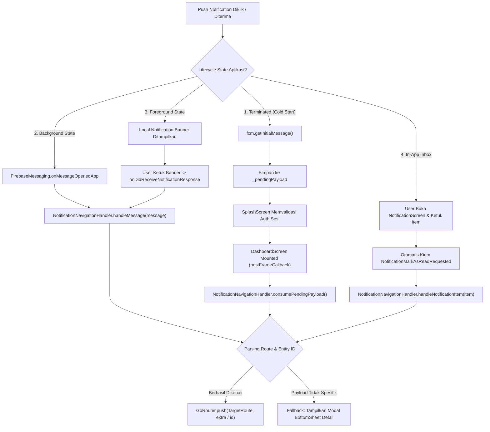

# 📢 Spesifikasi & Standar Kontrak Notifikasi HRIS (Push FCM & In-App Routing)

Dokumen ini merupakan panduan teknis resmi (*Single Source of Truth*) untuk arsitektur notifikasi, payload Firebase Cloud Messaging (FCM), serta penanganan **Click Action / Deep Linking** di seluruh ekosistem **Muratech HRIS**:
- **Backend API**: `muratech_hris_server`
- **Web Frontend & Server Actions**: `hris-web`
- **Mobile Application**: `hris_flutter`

---

## 1. Arsitektur Transport & Standar Kanal OS

Agar notifikasi dapat ditampilkan dengan prioritas tinggi (*Heads-up banner*), memutar suara default, dan dapat diklik secara andal di seluruh platform OS (Android & iOS):

### 1.1 Android Channel Specification
- **Notification Channel ID**: `muratech_hris_channel`
- **Channel Name**: `Notifikasi HRIS Muratech`
- **Importance**: `Importance.high` (Android 8.0 / API 26+)
- **Sound**: `default`
- **Intent Action Filter**: `FLUTTER_NOTIFICATION_CLICK` (Didaftarkan di `AndroidManifest.xml` pada `.MainActivity`)

### 1.2 iOS APNs Specification
- **Sound**: `'default'`
- **Badge**: `1` (Otomatis ditangani oleh Apple Push Notification service)

### 1.3 Format Pesan FCM Standar (Firebase Admin SDK)
Setiap pengiriman notifikasi dari backend (`sendNotificationToEmployees`) atau web (`sendRawMulticastNotification`) **wajib** mengikuti struktur berikut:

```typescript
const message = {
  token: targetDeviceToken,
  notification: {
    title: 'Judul Notifikasi',
    body: 'Isi ringkas notifikasi...',
    imageUrl: optionalImageUrl, // Opsional
  },
  data: {
    ...customData, // Record<string, string>
    title: 'Judul Notifikasi',
    body: 'Isi ringkas notifikasi...',
    click_action: 'FLUTTER_NOTIFICATION_CLICK', // Wajib untuk routing Android
  },
  android: {
    priority: 'high',
    notification: {
      channelId: 'muratech_hris_channel', // Wajib konsisten dengan Flutter
      sound: 'default',
      clickAction: 'FLUTTER_NOTIFICATION_CLICK',
    },
  },
  apns: {
    payload: {
      aps: {
        sound: 'default',
        badge: 1,
      },
    },
  },
}
```

---

## 2. Matriks Lengkap Notification Types, Payloads & Target Rute

Tabel di bawah ini mendefinisikan seluruh tipe event notifikasi, payload data `Record<string, string>`, penerima, dan rute tujuannya di aplikasi mobile (`hris_flutter`) serta web (`hris-web`):

| No | Modul | Sumber Emiter | `data.type` / Event Key | Penerima | Payload `data` | Target Rute Mobile (`hris_flutter`) | Target Rute Web (`actionUrl`) |
|:---|:---|:---|:---|:---|:---|:---|:---|
| 1 | **Presensi** | Server | `attendance_request` | Approver / Atasan | `{ type: 'attendance_request', id: string }` | `Routes.ATTENDANCE_REQUEST_DETAIL`<br>`extra: {'id': id, 'isApprover': true}` | `/approval/attendances/{id}` |
| 2 | **Presensi** | Server | `attendance_request` | Pemohon | `{ type: 'attendance_request', id: string }` | `Routes.ATTENDANCE_REQUEST_DETAIL`<br>`extra: {'id': id, 'isApprover': false}` | `/report-kehadiran` |
| 3 | **Cuti & Izin** | Server | `leave_request` | Approver / Atasan | `{ type: 'leave_request', id: string }` | `Routes.LEAVE_DETAIL`<br>`extra: {'id': id, 'isApprover': true}` | `/approval/leaves/{id}` |
| 4 | **Cuti & Izin** | Server | `leave_request` | Pemohon | `{ type: 'leave_request', id: string }` | `Routes.LEAVE_DETAIL`<br>`extra: {'id': id, 'isApprover': false}` | `/approval/leaves/{id}` |
| 5 | **Lembur** | Server | `overtime_request` | Approver / Atasan | `{ type: 'overtime_request', id: string }` | `Routes.OVERTIME_DETAIL`<br>`extra: {'id': id, 'isApprover': true}` | `/approval/overtimes/{id}` |
| 6 | **Lembur** | Server | `overtime_request` | Pemohon | `{ type: 'overtime_request', id: string }` | `Routes.OVERTIME_DETAIL`<br>`extra: {'id': id, 'isApprover': false}` | `/approval/overtimes/{id}` |
| 7 | **Aktivitas** | Server | `activity` | Karyawan Ditugaskan | `{ type: 'activity', id: string }` | `Routes.ACTIVITY_DETAIL`<br>`extra: id` | `/report-aktivities` |
| 8 | **Aktivitas** | Server | `activity` | Atasan / Reviewer | `{ type: 'activity', id: string }` | `Routes.ACTIVITY_DETAIL`<br>`extra: id` | `/report-aktivities` |
| 9 | **Surat Peringatan** | Server | `warning_letter` | Karyawan Penerima | `{ type: 'warning_letter', id: string }` | `Routes.WARNING_LETTER_DETAIL`<br>`extra: id` | `/warning-letter` |
| 10 | **Pengunduran Diri** | Server | `resignation` | Atasan / HR Manager | `{ type: 'resignation', id: string, resignationId: string, module: 'RESIGNATION' }` | `Routes.RESIGNATION` | `/approval/resignation` |
| 11 | **Fasilitas Aset** | Server | `asset_handover` | Karyawan Penerima | `{ type: 'asset_handover', id: string, assetId: string, assignmentId: string }` | `Routes.ASSETS` | `/assets` |
| 12 | **Fasilitas Aset** | Server | `asset_transfer` | Target Penerima | `{ type: 'asset_transfer', id: string, assetId: string, assignmentId: string }` | `Routes.ASSETS` | `/assets` |
| 13 | **Fasilitas Aset** | Server | `asset_approved` | Karyawan Pengalih | `{ type: 'asset_approved', id: string, assetId: string, assignmentId: string }` | `Routes.ASSETS` | `/assets` |
| 14 | **Fasilitas Aset** | Server | `asset_rejected` | Karyawan Pengalih | `{ type: 'asset_rejected', id: string, assetId: string, assignmentId: string }` | `Routes.ASSETS` | `/assets` |
| 15 | **Reimbursement** | Server | `reimbursement` | Approver / Pemohon | `{ type: 'reimbursement', id: string }` | `Routes.REIMBURSEMENT_DETAIL`<br>`extra: id` | `/approval/reimbursements/{id}` |
| 16 | **Kasbon** | Server | `cash_advance` | Approver / Pemohon | `{ type: 'cash_advance', id: string }` | `Routes.CASH_ADVANCE_DETAIL`<br>`extra: id` | `/approval/reimbursements` |
| 17 | **Pengumuman** | Web | `announcement` | Seluruh Karyawan | `{ type: 'announcement', id: string, priority: string, category: string }` | `Routes.ANNOUNCEMENT_DETAIL`<br>`extra: id` | `/announcement` |
| 18 | **Web Submission** | Web | `{entity}_new_submission` | Approver | `{ type: '{entity}_new_submission', id: string }` | Sesuai Entity (`*_DETAIL`)<br>`extra: {'id': id, 'isApprover': true}` | `/approval/{entities}/{id}` |
| 19 | **Web Confirmation** | Web | `{entity}_submission_confirmation` | Pemohon | `{ type: '{entity}_submission_confirmation', id: string }` | Sesuai Entity (`*_DETAIL`)<br>`extra: {'id': id, 'isApprover': false}` | `/approval/{entities}/{id}` |
| 20 | **Web Approval** | Web | `{entity}_approval` | Pemohon | `{ type: '{entity}_approval', id: string, status: string, actionUrl: string }` | Sesuai Entity (`*_DETAIL`)<br>`extra: {'id': id, 'isApprover': false}` | URL di `actionUrl` |
| 21 | **Web Correction** | Web | `attendance_request` | Karyawan | `{ date: string, actionUrl: '/report-kehadiran' }` | `Routes.ATTENDANCE_LOGS` | `/report-kehadiran` |
| 22 | **Slip Gaji** | Server/Web | `payroll` | Karyawan | `{ type: 'payroll', id: string }` | `Routes.PAYROLL_DETAIL`<br>`extra: id` (atau `Routes.PAYROLL`) | `/pay-slips` |

---

## 3. Siklus Hidup Penanganan di Mobile (`hris_flutter`)

Aplikasi Flutter menangani klik notifikasi melalui kelas terpusat **`NotificationNavigationHandler`**:



### 3.1 Penjelasan State Lifecycle:

1. **Terminated State (Aplikasi Tertutup Total)**:
   - Pengguna mengetuk notifikasi di bilah OS.
   - Aplikasi diluncurkan dari nol. `fcm.getInitialMessage()` menangkap payload.
   - Payload disimpan ke buffer `_pendingPayload` agar tidak hilang atau tertimpa oleh navigasi `SplashScreenPage`.
   - Begitu sesi tervalidasi dan `DashboardScreen` selesai di-*render*, `consumePendingPayload()` dieksekusi untuk membuka rute detail di atas Dashboard.
2. **Background State**:
   - Pengguna mengetuk notifikasi saat aplikasi berada di latar belakang.
   - Stream `FirebaseMessaging.onMessageOpenedApp` menerima pesan dan langsung menavigasikannya secara instan.
3. **Foreground State**:
   - Aplikasi sedang aktif dibuka oleh pengguna.
   - FCM menampilkan notifikasi heads-up lokal via `flutter_local_notifications` dengan payload JSON.
   - Saat pop-up diketuk, callback `onDidReceiveNotificationResponse` mendecode JSON dan meneruskan ke `NotificationNavigationHandler`.
4. **In-App Inbox (`NotificationScreen`)**:
   - Pengguna membuka halaman Pusat Notifikasi dari Dashboard.
   - Mengetuk item kartu notifikasi secara otomatis mengirimkan event `NotificationMarkAsReadRequested(id)` untuk menandai sebagai telah dibaca.
   - Handler memetakan data dan langsung membuka layar detail yang bersangkutan.

---

## 4. Aturan Kontrak Backend & Validasi

1. **Selalu Sertakan `type` dan `id`**:
   Semua modul baru yang mengirim notifikasi wajib menyertakan atribut `type` (nama modul/event dalam format *snake_case*) dan `id` (UUID entitas) di dalam objek `data`.
2. **Backward-Compatibility Alias**:
   Jika terdapat key historis (seperti `resignationId`, `assetId`, `assignmentId`), tetap sertakan key umum `id` sebagai alias agar kompatibel ke seluruh platform.
3. **Semua Nilai di `data` Wajib Berupa String**:
   FCM Firebase Admin SDK membatasi payload `data` berupa `Record<string, string>`. Jangan mengirim nilai berupa `boolean` murni, `number`, atau `object` nested tanpa di-serialize `toString()` atau `JSON.stringify()`.
4. **Penyaringan Preferensi Notifikasi (`EmployeeNotificationSetting`)**:
   Sebelum mengirim push notifikasi, backend wajib memeriksa tabel `EmployeeNotificationSetting` penerima (`pushLeave`, `pushAttendanceRequest`, `pushOvertime`, dll.) untuk menghormati preferensi privasi pengguna.
