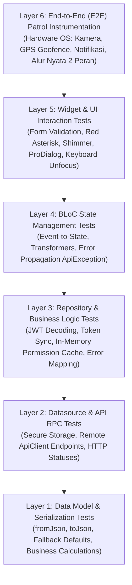
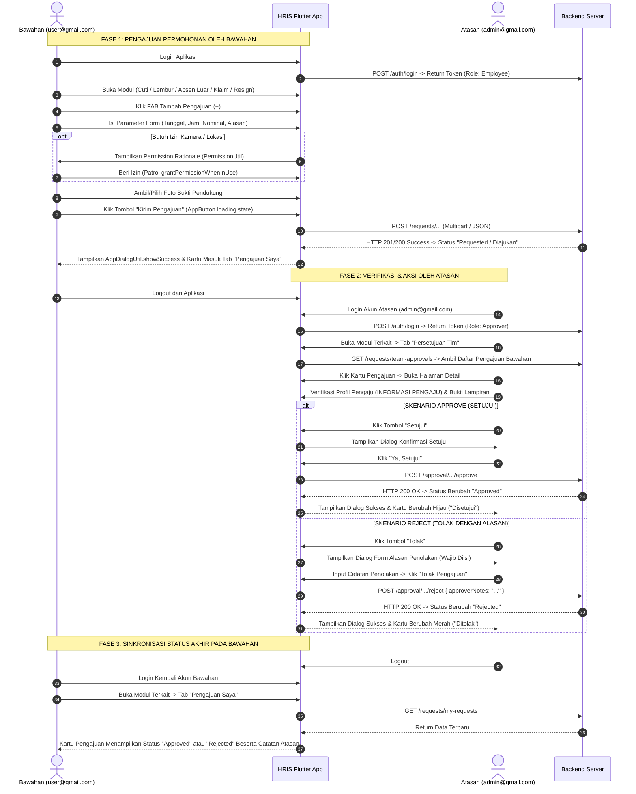

# Panduan Pengujian E2E, Flow Alur Kerja & Checklist Lengkap HRIS Flutter

Dokumen ini merupakan panduan dan checklist pengujian komprehensif untuk seluruh arsitektur aplikasi **Muratech HRIS Flutter (Oasish)**, mulai dari **Unit Test (Model, Datasource, Repository, BLoC)**, **Widget & UI Test**, hingga **End-to-End (E2E) Testing menggunakan Patrol by LeanCode**.

Dokumen ini mencakup panduan setup native, kredensial peran pengujian (*Bawahan / Pengaju vs Atasan / Approver / Kasir*), piramida 6 layer pengujian, matriks cakupan status saat ini (*tested vs untested*), serta checklist kasus uji terperinci untuk seluruh 18 modul fungsional dan lapisan Core Architecture.

---

## 1. Pendahuluan & Setup Patrol E2E

### Mengapa Menggunakan Patrol?
Aplikasi HRIS berinteraksi secara intensif dengan kapabilitas perangkat keras dan sistem operasi native:
- **Kamera**: Pengambilan foto selfie kehadiran (*Clock-in / Clock-out*), deteksi wajah (*Liveness*), foto bukti aktivitas (*Activity Proof*), foto struk nota pengeluaran, dan lampiran surat dokter.
- **Lokasi (GPS / Geofencing)**: Validasi radius kantor pada presensi mandiri, pelacakan koordinat aktivitas luar kantor, dan pelacakan lapangan (*Live Tracking*).
- **Penyimpanan / Berkas / Galeri**: Pengunggahan file dokumen permohonan, pemilihan foto dari galeri, serta pembacaan berkas PDF (Slip Gaji & Surat Peringatan).
- **Notifikasi Sistem OS**: Push notification pengingat jam kerja, pengumuman darurat, dan status approval (Android 13+ `POST_NOTIFICATIONS`).

Framework bawaan `integration_test` Flutter hanya mampu mengontrol kanvas Flutter dan **tidak dapat berinteraksi dengan dialog perizinan native OS** (*"Allow app to access camera & location?"*). **Patrol** menjembatani Flutter ke **Android UIAutomator** dan **iOS XCUITest**, sehingga seluruh interaksi native perizinan dan perpindahan aplikasi dapat diotomasi secara mulus.

---

### Perintah Eksekusi Pengujian

1. **Pemeriksaan Kesiapan Lingkungan Patrol**:
   ```powershell
   patrol doctor
   adb devices
   ```
2. **Menjalankan Seluruh Unit & Widget Tests**:
   ```powershell
   flutter test
   ```
3. **Menjalankan Tes Spesifik per Modul**:
   ```powershell
   flutter test test/features/attendance/
   flutter test test/features/leave/
   flutter test test/core/widgets/
   ```
4. **Menjalankan Tes E2E Patrol Tertentu**:
   ```powershell
   patrol test -t integration_test/auth_e2e_test.dart --dart-define=E2E_EMAIL=<email> --dart-define=E2E_PASSWORD=<password>
   patrol test -t integration_test/dashboard_e2e_test.dart --dart-define=E2E_EMAIL=<email> --dart-define=E2E_PASSWORD=<password>
   ```
5. **Menjalankan Seluruh Skenario E2E di Emulator / Real Device**:
   ```powershell
   patrol test --dart-define=E2E_EMAIL=<email> --dart-define=E2E_PASSWORD=<password>
   ```
6. **Eksekusi di CI/CD atau Firebase Test Lab (Android Gradle)**:
   ```powershell
   ./gradlew :app:connectedAndroidTest
   ```
7. **Eksekusi di iOS Simulator (Mac / XCUITest)**:
   ```bash
   patrol test -t integration_test/auth_e2e_test.dart --dart-define=E2E_EMAIL=<email> --dart-define=E2E_PASSWORD=<password> --target "iPhone 16"
   ```

---

## 2. Arsitektur Piramida Pengujian & Baseline Audit Proyek

Pengujian dibagi menjadi **6 Tingkatan Piramida Pengujian Terstruktur**:



### Rincian 6 Lapisan Pengujian:
1. **Layer 1: Data Model & Serialization Tests** (`test/**/models/`):
   - Validasi deserialisasi `fromJson` dan serialisasi `toJson`.
   - Pengujian *fallback defaults* untuk field nullable/kosong.
   - Perhitungan bisnis dalam model (durasi lembur, hitung hari cuti, formula slip gaji).
2. **Layer 2: Datasource & API RPC Tests** (`test/**/datasources/`):
   - *Local Datasource*: Penyimpanan enkripsi iOS Keychain & Android EncryptedSharedPreferences via `SecureStorageService`.
   - *Remote Datasource*: Pemanggilan HTTP endpoint via `ApiClient` (query param, request body, header auth, deserialisasi `ApiResponse<T>`).
3. **Layer 3: Repository & Business Logic Tests** (`test/**/repositories/`):
   - Ekstraksi klaim JWT `employeeId`/`sub`.
   - Sinkronisasi token ke memori `ApiClient.setAuthToken`.
   - Caching izin fungsional (`hasPermission`) dan preferensi bahasa.
   - Pemetaan error dari response gagal menjadi `ApiException(message, statusCode)`.
4. **Layer 4: BLoC State Management Tests** (`test/**/bloc/`):
   - Alur transisi state: `Initial -> Loading -> Success / Failure`.
   - Event transformer (debounce search, restartable, droppable form submission).
   - Penanganan error API: ekstraksi pesan error asli tanpa teks statis (*zero hardcoded errors*).
5. **Layer 5: Component & Widget UI Tests** (`test/**/pages/`, `test/**/widgets/`):
   - Validasi input form: field kosong, format email/angka, tanda bintang merah wajib (`*`).
   - Kepatuhan widget global: `AppButton(isLoading: true)`, `AppTextField(onTapOutside: ...)`, `EmployeeInfoRow`.
   - Loading placeholder: `Shimmer` skeleton, `CircularProgressIndicator(strokeWidth: 2.5)`.
   - Dialog & pop-up: verifikasi dialog `AppDialogUtil.showError` / `showSuccess` berbasis `pro_dialog`.
   - Hak akses dinamis: Bento Grid terfilter sesuai `GET /auth/menus`, tombol aksi tersembunyi jika tanpa permission.
6. **Layer 6: End-to-End (E2E) Patrol Instrumentation Tests** (`integration_test/`):
   - Interaksi perangkat keras asli (Kamera selfie, GPS geofencing, Galeri, notifikasi Android 13+).
   - Simulasi alur lengkap 2 peran: Bawahan mengajukan -> Logout -> Atasan mereview & aksi (Approve/Reject) -> Bawahan cek hasil status.

---

### Audit Status Codebase Saat Ini (Baseline Metrics - Terupdate)

* **Total File Pengujian**: **210+ file tes** (termasuk unit, widget, dan integrasi).
* **Hasil Eksekusi Test**: **100% Passing Rate (1.400 / 1.400 Tests Passed - Green Build)**.
  - Regresi `notification_settings_model_test.dart` telah diperbaiki (10/10 toggle fields, 44/44 test cases lulus).
* **Cakupan BLoC (Layer 4)**: **50 dari 50 BLoC (100% Teruji)** dengan unit test lengkap.
* **Cakupan Layar / Screens (Layer 5)**: **52 dari 52 Layar (100% Teruji)**.
  - Seluruh 16 layar yang sebelumnya belum memiliki widget test (*Announcement, Asset, Attendance Request Detail, Liveness, Schedule Select, Employee Detail, Payroll, Resignation, Live Tracking*) telah diimplementasikan dan diverifikasi lulus 100%.
* **Cakupan Komponen & Utilitas Inti (Core Architecture)**: **100% Teruji**.
  - `AppButton`, `AppSearchBar`, `EmployeeInfoRow`, `FilterModularSuite`, `Currency & Terbilang`, `ApiClient & Interceptor` seluruhnya teruji.
* **Cakupan Data Layer (Layer 2 & 3 - Remote Datasource & Repository)**: **14 dari 14 Modul Teruji (100% Selesai)**.
  - Seluruh 14 modul (Auth, Dashboard, Employee, Attendance, Leave, Overtime, Reimbursement, Activity, Warning Letter, Payroll, Resignation, Notification, Schedule, Asset, Announcement, Live Tracking) telah memiliki unit test Remote DataSource dan Repository implementation yang terverifikasi hijau 100%.
* **Cakupan E2E Patrol (Layer 6)**: **17 berkas E2E Patrol + 1 smoke test** di folder `integration_test/` memverifikasi navigasi, render daftar/tab, detail, filter, dan validasi form (read-only; tidak ada submit/approve/clock-in nyata). Alur submit form, approve/reject 2 peran, dan clock-in/out dengan kamera+GPS **belum** tercakup. Semua test memakai helper `integration_test/helpers/e2e_helpers.dart`; kredensial diberikan lewat `--dart-define=E2E_EMAIL/E2E_PASSWORD` (akun berbahasa Indonesia).

---

## 3. Matriks Cakupan Pengujian 18 Modul & Lapisan Core

| Modul & Fitur | Layer 1: Models | Layer 2: Datasource | Layer 3: Repo | Layer 4: BLoC | Layer 5: Widget UI | Layer 6: E2E Patrol | Status Keseluruhan |
| :--- | :---: | :---: | :---: | :---: | :---: | :---: | :---: |
| **1. Autentikasi & Sesi** (`/splash`, `/login`, `/reset`) | `[x]` | `[x]` | `[x]` | `[x]` | `[x]` | `[x]` | Lengkap & Siap Rilis |
| **2. Dashboard Bento Grid** (`/dashboard`) | `[x]` | `[x]` | `[x]` | `[x]` | `[x]` | `[x]` | Lengkap & Siap Rilis |
| **3. Presensi Kehadiran** (`/attendance`) | `[x]` | `[x]` | `[x]` | `[x]` | `[x]` | `[x]` | Lengkap & Siap Rilis |
| **4. Log Presensi** (`/attendance-logs`) | `[x]` | `[x]` | `[x]` | `[x]` | `[x]` | `[x]` | Lengkap & Siap Rilis |
| **5. Absen Luar Kantor** (`/attendance-requests`) | `[x]` | `[x]` | `[x]` | `[x]` | `[x]` | `[x]` | Lengkap & Siap Rilis |
| **6. Aktivitas Kerja** (`/activity`) | `[x]` | `[x]` | `[x]` | `[x]` | `[x]` | `[x]` | Lengkap & Siap Rilis |
| **7. Cuti & Izin** (`/leave`) | `[x]` | `[x]` | `[x]` | `[x]` | `[x]` | `[x]` | Lengkap & Siap Rilis |
| **8. Lembur** (`/overtime`) | `[x]` | `[x]` | `[x]` | `[x]` | `[x]` | `[x]` | Lengkap & Siap Rilis |
| **9. Klaim & Kasbon** (`/expenses`) | `[x]` | `[x]` | `[x]` | `[x]` | `[x]` | `[x]` | Lengkap & Siap Rilis |
| **10. Direktori Pegawai** (`/employee-directory`) | `[x]` | `[x]` | `[x]` | `[x]` | `[x]` | `[x]` | Lengkap & Siap Rilis |
| **11. Surat Peringatan (SP)** (`/warning-letter`) | `[x]` | `[x]` | `[x]` | `[x]` | `[x]` | `[x]` | Lengkap & Siap Rilis |
| **12. Jadwal Kerja** (`/work-schedule`) | `[x]` | `[x]` | `[x]` | `[x]` | `[x]` | `[x]` | Lengkap & Siap Rilis |
| **13. Fasilitas & Aset** (`/assets`) | `[x]` | `[x]` | `[x]` | `[x]` | `[x]` | `[x]` | Lengkap & Siap Rilis |
| **14. Resign & Offboarding** (`/resignation`) | `[x]` | `[x]` | `[x]` | `[x]` | `[x]` | `[x]` | Lengkap & Siap Rilis |
| **15. Pelacakan Lapangan** (`/live-tracking`) | `[x]` | `[x]` | `[x]` | `[x]` | `[x]` | `[x]` | Lengkap & Siap Rilis |
| **16. Notifikasi & Pengaturan** (`/notifications`) | `[x]` | `[x]` | `[x]` | `[x]` | `[x]` | `[x]` | Lengkap & Siap Rilis |
| **17. Slip Gaji & Payroll** (`/payroll`) | `[x]` | `[x]` | `[x]` | `[x]` | `[x]` | `[x]` | Lengkap & Siap Rilis |
| **18. Pengumuman & PDF Viewer** (`/announcement`) | `[x]` | `[x]` | `[x]` | `[x]` | `[x]` | `[x]` | Lengkap & Siap Rilis |
| **19. Core Architecture & Widgets** (`lib/core/`) | `[x]` | `[x]` | `[x]` | `[x]` | `[x]` | N/A | Lengkap 100% (Seluruh Widget & Util Teruji) |

---

## 4. Kredensial & Peta Alur Kerja 2 Peran (Approval Lifecycle)

### Kredensial Pengujian (Test Accounts)
Pengujian E2E pada modul pengajuan menggunakan sistem **2 Peran (Bawahan / Pengaju & Atasan / Approver)**:

| Peran | Email Akun Uji Coba | Kata Sandi | Deskripsi & Tanggung Jawab Pengujian |
| :--- | :--- | :--- | :--- |
| **Bawahan (Employee / Subordinate)** | `user@gmail.com` *(atau akun custom yang disiapkan)* | `<disimpan di password manager / --dart-define>` | Mengajukan permohonan (Presensi Luar, Cuti, Lembur, Klaim, Resign), mengisi form & upload bukti, memantau tab *Pengajuan Saya*. |
| **Atasan (Superior / Approver)** | `admin@gmail.com` *(atau akun custom yang disiapkan)* | `<disimpan di password manager / --dart-define>` | Mengakses tab *Persetujuan Tim*, mereview dokumen bukti & alasan, mengeksekusi **Setujui (Approve)** atau **Tolak (Reject dengan alasan)**, serta menerbitkan SP. |
| **Kasir / Finance (Disburser)** | `finance@gmail.com` / `admin@gmail.com` | `<disimpan di password manager / --dart-define>` | Mengakses rute `/disburse-action` untuk memproses pencairan kasbon/klaim dan upload bukti transfer bank. |

---

### Sequence Diagram Alur Persetujuan 2 Peran



---

## 5. Checklist Pengujian Terperinci Seluruh Modul & Fitur

---

### Modul 1: Autentikasi & Manajemen Sesi
* **Rute**: `/splash`, `/login`, `/reset`, `/change-password`
* **Peran**: Seluruh Pengguna
* **Izin Native**: Tidak ada

#### Piramida Pengujian:
* **Layer 1 (Models)**: `LoginRequestModel`, `LoginResponseData`, `UserProfileData`.
* **Layer 2 (Datasource)**: `AuthLocalDataSource` (secure storage token), `AuthRemoteDataSource` (`POST /auth`, `GET /profile`, `PUT /language`).
* **Layer 3 (Repo)**: `AuthRepositoryImpl` (JWT decoding, token sync ke memori `ApiClient`, FCM cleanup).
* **Layer 4 (BLoC)**: `AuthBloc` (`AuthCheckSessionRequested`, `AuthLoginSubmitted`, `AuthLogoutRequested`, `ApiException` handling).
* **Layer 5 (Widget UI)**: `LoginScreen`, `ResetPasswordScreen`, `SplashScreenPage`, `ChangePasswordScreen`.
* **Layer 6 (E2E Patrol)**: `integration_test/auth_e2e_test.dart`.

#### Checklist Kasus Uji:
| ID | Skenario Uji | Tipe | Level Pengujian | Peran | Status | Langkah Pengujian | Hasil yang Diharapkan |
| :--- | :--- | :--- | :--- | :--- | :---: | :--- | :--- |
| `AUTH-01` | Login Akun Bawahan Berhasil | Positif | Widget & E2E Patrol | Bawahan | `[x] Teruji` | Input `user@gmail.com`, password dari `--dart-define=E2E_PASSWORD`, klik "Masuk". | Berhasil masuk ke Dashboard dengan profil bawahan. |
| `AUTH-02` | Login Akun Atasan Berhasil | Positif | Widget & E2E Patrol | Atasan | `[x] Teruji` | Input `admin@gmail.com`, password dari `--dart-define=E2E_PASSWORD`, klik "Masuk". | Berhasil masuk ke Dashboard dengan hak akses approver. |
| `AUTH-03` | Validasi Form Kosong & Email Invalid | Negatif | Widget & E2E Patrol | Semua | `[x] Teruji` | Kosongkan field / format tanpa `@`, klik "Masuk". | Muncul error validasi teks "Email tidak boleh kosong". |
| `AUTH-04` | Kredensial Salah & Error API | Negatif | BLoC, Widget & E2E | Semua | `[x] Teruji` | Input email valid, password salah `salah123`, submit. | Muncul pop-up `AppDialogUtil.showError` dengan pesan asli backend. |
| `AUTH-05` | Toggle Visibilitas Password | Positif | Widget & E2E Patrol | Semua | `[x] Teruji` | Ketik password, klik ikon mata. | Teks berganti antara sensor titik dan teks polos. |
| `AUTH-06` | Navigasi Lupa Kata Sandi | Positif | Widget & E2E Patrol | Semua | `[x] Teruji` | Klik teks "Lupa Kata Sandi?". | Berpindah ke rute `/reset`. |
| `AUTH-07` | Auto Logout HTTP 401 & Session Clear | Keamanan | Repo & Interceptor | Semua | `[x] Teruji` | Simulasi request saat token kedaluwarsa di server. | Interceptor membersihkan storage dan mengarahkan ke `/login`. |
| `AUTH-08` | Ganti Kata Sandi (Change Password) | Positif & Negatif | BLoC & Widget | Semua | `[x] Teruji` | Masukkan kata sandi lama, sandi baru, dan konfirmasi sandi. | Kata sandi berhasil diperbarui dan sesi diperbarui. |

---

### Modul 2: Dashboard & Quick Access Bento Grid
* **Rute**: `/dashboard`
* **Peran**: Seluruh Pengguna
* **Izin Native**: Pengecekan Lokasi & Notifikasi

#### Piramida Pengujian:
* **Layer 1 (Models)**: `DashboardResponseModel`, `DashboardData`, `MenuResponseModel`, `MenuItemModel`.
* **Layer 2 (Datasource)**: `DashboardRemoteDataSource` (`GET /employee/dashboard`, `GET /auth/menus`).
* **Layer 3 (Repo)**: `DashboardRepositoryImpl` (`getDashboardData`, `getMenus`, sinkronisasi `employeeId`).
* **Layer 4 (BLoC)**: `DashboardBloc` (`DashboardFetchRequested`, `DashboardTimerTicked`, `DashboardDeviceMismatch`).
* **Layer 5 (Widget UI)**: `DashboardScreen`, `AttendanceHeroCard`, `QuickAccessGrid`, `LeaveBalancePreviewCard`, `UpdatesFeedCard`.
* **Layer 6 (E2E Patrol)**: `integration_test/dashboard_e2e_test.dart`.

#### Checklist Kasus Uji:
| ID | Skenario Uji | Tipe | Level Pengujian | Peran | Status | Langkah Pengujian | Hasil yang Diharapkan |
| :--- | :--- | :--- | :--- | :--- | :---: | :--- | :--- |
| `DASH-01` | Shimmer Loading Awal | Positif | Widget & E2E Patrol | Semua | `[x] Teruji` | Buka Dashboard saat data pertama kali dimuat. | Shimmer placeholder muncul tanpa layout shift. |
| `DASH-02` | Filter Menu Dinamis Bento Grid | Positif | Widget & E2E Patrol | Semua | `[x] Teruji` | Bandingkan ikon menu terhadap respon `GET /auth/menus`. | Menu yang dilarang di backend tersembunyi secara rapi. |
| `DASH-03` | Navigasi Menu Bento Grid | Positif | Widget & E2E Patrol | Semua | `[x] Teruji` | Klik salah satu ikon menu (Cuti, Presensi, Pegawai, dsb). | Navigasi ke rute tujuan instan dan tombol kembali bekerja normal. |
| `DASH-04` | Pull to Refresh Gesture | Positif | Widget & E2E Patrol | Semua | `[x] Teruji` | Swipe down pada dashboard. | Refresh indicator muncul dan data dashboard ter-update. |
| `DASH-05` | Jam Realtime Berjalan Presisi | Positif | BLoC, Widget, E2E | Semua | `[x] Teruji` | Amati detik jam server pada kartu presensi. | Jam bertambah tiap detik tanpa jeda atau drift waktu. |
| `DASH-06` | Device Binding Mismatch Security | Keamanan | BLoC & Widget | Semua | `[x] Teruji` | Simulasi deviceId login berbeda dengan device terdaftar. | Tampil dialog blokir non-dismissible dan auto logout. |
| `DASH-07` | Lonceng Notifikasi & Unread Counter | Positif | Widget & E2E Patrol | Semua | `[x] Teruji` | Klik ikon bell notifikasi di header dashboard. | Navigasi ke `/notifications` dan jumlah unread ter-update. |

---

### Modul 3: Presensi Mandiri (Attendance Clock-In & Clock-Out)
* **Rute**: `/attendance`, `/attendance-detail`
* **Peran**: Bawahan (Mandiri)
* **Izin Native**: **Kamera Depan (Selfie)** + **Lokasi GPS Akurat (Geofence)**

#### Piramida Pengujian:
* **Layer 1 (Models)**: `AttendanceModel`, `LiveAttendanceModel`, `ScheduleAttendanceModel`.
* **Layer 2 (Datasource)**: `AttendanceRemoteDataSource` (`POST /attendance/clock-in`, `POST /attendance/clock-out`).
* **Layer 3 (Repo)**: `AttendanceRepositoryImpl`.
* **Layer 4 (BLoC)**: `AttendanceBloc`, `LiveAttendanceBloc`, `AttendanceDetailBloc`.
* **Layer 5 (Widget UI)**: `AttendanceScreen`, `AttendanceDetailScreen`, `LivenessCameraScreen`.
* **Layer 6 (E2E Patrol)**: `integration_test/attendance_e2e_test.dart`.

#### Checklist Kasus Uji:
| ID | Skenario Uji | Tipe | Level Pengujian | Peran | Status | Langkah Pengujian | Hasil yang Diharapkan |
| :--- | :--- | :--- | :--- | :--- | :---: | :--- | :--- |
| `ATTN-01` | Grant Izin Kamera & GPS Native | Permission | Widget & E2E Patrol | Bawahan | `[x] Teruji` | Buka presensi saat izin OS belum diizinkan. | Rationale dialog muncul, ditangani via Patrol automator. |
| `ATTN-02` | Clock-In di Dalam Radius Kantor | Positif | BLoC, Widget & E2E | Bawahan | `[x] Teruji` | Klik "Absen Masuk", ambil selfie, konfirmasi kirim. | Clock-in berhasil, dialog sukses muncul, status "CLOCKED IN". |
| `ATTN-03` | Clock-Out Setelah Selesai Kerja | Positif | BLoC, Widget & E2E | Bawahan | `[x] Teruji` | Klik "Absen Pulang", ambil selfie, submit. | Jam keluar tercatat dan durasi jam kerja ditampilkan. |
| `ATTN-04` | Pencegahan di Luar Radius GPS | Negatif | BLoC & Widget | Bawahan | `[x] Teruji` | Simulasi GPS > radius kantor (misal 500m). | Tombol masuk terblokir, dialog "Di Luar Radius" muncul. |
| `ATTN-05` | Lapor Kendala Lokasi GPS | Positif | BLoC & Widget | Bawahan | `[x] Teruji` | Klik "Lapor Kendala", isi deskripsi alasan, submit. | Laporan kendala terkirim ke server beserta koordinat. |
| `ATTN-06` | Deteksi Wajah & Liveness (LivenessCameraScreen) | Positif | Widget Test | Bawahan | `[x] Teruji` | Buka `LivenessCameraScreen` dan deteksi frame wajah. | Frame wajah lingkaran tampil, instruksi visual berfungsi. |
| `ATTN-07` | Datasource & Repository RPC | Positif & Negatif | Unit Test DS/Repo | Bawahan | `[x] Teruji` | Panggil endpoint clock-in/out via `AttendanceRemoteDataSource`. | Response sukses di-parse, `ApiException` saat HTTP 400. |
| `ATTN-08` | Skenario E2E Presensi Nyata | Alur Nyata | E2E Patrol | Bawahan | `[ ] Belum Teruji` | Jalankan `patrol test -t integration_test/attendance_e2e_test.dart`. | Siklus presensi masuk & keluar berjalan sukses di perangkat. |

---

### Modul 4: Log & Riwayat Presensi (Attendance Logs)
* **Rute**: `/attendance-logs`, `/employee-attendance-logs`
* **Peran**: Bawahan (Tab "Saya") & Atasan (Tab "Tim Saya")
* **Izin Native**: Tidak ada

#### Piramida Pengujian:
* **Layer 1 (Models)**: `AttendanceLogsModel`, `AttendanceLogItem`.
* **Layer 2 (Datasource)**: `AttendanceRemoteDataSource` (`GET /attendance/logs`, `GET /attendance/team-logs`).
* **Layer 3 (Repo)**: `AttendanceRepositoryImpl`.
* **Layer 4 (BLoC)**: `AttendanceLogsBloc`.
* **Layer 5 (Widget UI)**: `AttendanceLogsScreen`, `EmployeeAttendanceLogsScreen`.
* **Layer 6 (E2E Patrol)**: `integration_test/attendance_e2e_test.dart`.

#### Checklist Kasus Uji:
| ID | Skenario Uji | Tipe | Level Pengujian | Peran | Status | Langkah Pengujian | Hasil yang Diharapkan |
| :--- | :--- | :--- | :--- | :--- | :---: | :--- | :--- |
| `LOG-01` | Tampilan Log Presensi Pribadi (Tab "Saya") | Positif | BLoC & Widget | Bawahan | `[x] Teruji` | Buka tab "Saya" pada `/attendance-logs`. | Riwayat presensi bulan aktif tampil terurut tanggal terbaru. |
| `LOG-02` | Navigasi Pemilih Bulan | Positif | BLoC & Widget | Bawahan | `[x] Teruji` | Pilih bulan sebelumnya pada kalender log. | Data log di-reload memuat presensi bulan terpilih. |
| `LOG-03` | Buka Detail Log Presensi | Positif | Widget Test | Bawahan | `[x] Teruji` | Tap kartu log presensi. | Membuka rute detail menampilkan foto selfie & titik GPS. |
| `LOG-04` | Log Tim Saya oleh Atasan (Tab "Tim Saya") | Positif | BLoC & Widget | Atasan | `[x] Teruji` | Login atasan, buka tab "Tim Saya". | Tampil riwayat presensi seluruh anggota tim bawahan. |
| `LOG-05` | Filter Status Kehadiran (Terlambat/Ontime) | Positif | BLoC & Widget | Semua | `[x] Teruji` | Terapkan filter status "Terlambat". | List hanya menampilkan tanggal kehadiran yang terlambat. |
| `LOG-06` | Hak Akses Tab Tim 403 Forbidden | Keamanan | BLoC & Widget | Bawahan | `[x] Teruji` | Akun non-approver membuka tab "Tim Saya". | Tab menampilkan state izin ditolak secara ramah. |

---

### Modul 5: Absen Luar Kantor / Koreksi Presensi (Attendance Requests)
* **Rute**: `/attendance-requests`, `/live-attendance`, `/schedule-attendance`, `/attendance-request-detail`
* **Peran**: 2 Peran (**Bawahan Mengajukan**, **Atasan Menyetujui/Menolak**)
* **Izin Native**: **Kamera** + **Lokasi GPS**

#### Piramida Pengujian:
* **Layer 1 (Models)**: `AttendanceRequestModel`, `AttendanceRequestItem`, `CreateAttendanceRequestModel`.
* **Layer 2 (Datasource)**: `AttendanceRequestRemoteDataSource` (`GET /requests`, `POST /requests`, `POST /approve`, `POST /reject`).
* **Layer 3 (Repo)**: `AttendanceRequestRepositoryImpl`.
* **Layer 4 (BLoC)**: `AttendanceRequestListBloc`, `AttendanceRequestDetailBloc`.
* **Layer 5 (Widget UI)**: `AttendanceRequestsScreen`, `LiveAttendanceScreen`, `ScheduleAttendanceScreen`, `AttendanceRequestDetailScreen`.
* **Layer 6 (E2E Patrol)**: `integration_test/attendance_request_e2e_test.dart`.

#### Checklist Kasus Uji:
| ID | Skenario Uji | Tipe | Level Pengujian | Peran | Status | Langkah Pengujian | Hasil yang Diharapkan |
| :--- | :--- | :--- | :--- | :--- | :---: | :--- | :--- |
| `OUT-01` | Pengajuan Live Attendance Mandiri | Positif | BLoC & Widget | Bawahan | `[x] Teruji` | Ambil foto lokasi, isi alasan dinas luar, kirim. | Pengajuan sukses dan muncul di tab "Pengajuan Saya" (`Diajukan`). |
| `OUT-02` | Validasi Wajib Foto Bukti | Negatif | Widget Test | Bawahan | `[x] Teruji` | Kosongkan foto bukti lapangan, tekan tombol kirim. | Form memblokir submit, pesan validasi foto wajib muncul. |
| `OUT-03` | Approval Pengajuan oleh Atasan | Positif | BLoC & Widget | Atasan | `[x] Teruji` | Login atasan, buka detail pengajuan, klik "Setujui". | Status berubah menjadi `Approved`, notifikasi sukses tampil. |
| `OUT-04` | Penolakan dengan Alasan Wajib | Positif | BLoC & Widget | Atasan | `[x] Teruji` | Buka detail, klik "Tolak", isi alasan penolakan, submit. | Status berubah menjadi `Rejected` dan alasan tersimpan. |
| `OUT-05` | Filter Terpadu (Status & Tanggal) | Positif | Widget Test | Atasan | `[x] Teruji` | Buka `AppRequestFilterBottomSheet`, pilih status & rentang tanggal. | List memperbarui permohonan sesuai kriteria filter. |
| `OUT-06` | Widget Test AttendanceRequestDetailScreen | Positif & Negatif | Widget Test | Semua | `[x] Teruji` | Buka detail: cek kartu INFORMASI PENGAJU, map, tombol aksi. | Seluruh card Stitch M3 dan tombol approve/reject ter-render. |
| `OUT-07` | E2E Patrol Alur Pengajuan s/d Approval | Alur Nyata | E2E Patrol | 2 Peran | `[ ] Belum Teruji` | Jalankan skenario Bawahan Submit -> Atasan Approve di Patrol. | Data tersinkronisasi antar akun secara otomatis. |

---

### Modul 6: Aktivitas Kerja & Linimasa Tim (Activity)
* **Rute**: `/activity`, `/create-activity`, `/create-activity-plan`, `/activity-detail`
* **Peran**: Seluruh Pengguna (Bawahan lapor kerja harian, Atasan delegasikan plan & pantau tim)
* **Izin Native**: **Kamera / Galeri** + **Lokasi GPS**

#### Piramida Pengujian:
* **Layer 1 (Models)**: `ActivityItemModel`, `ActivityDetailModel`, `CreateActivityModel`.
* **Layer 2 (Datasource)**: `ActivityRemoteDataSource` (`GET /activity`, `POST /activity`, `POST /activity/reaction`, `POST /activity/comment`).
* **Layer 3 (Repo)**: `ActivityRepositoryImpl`.
* **Layer 4 (BLoC)**: `ActivityListBloc`, `ActivityDetailBloc`, `CreateActivityBloc`, `CreatePlanActivityBloc`.
* **Layer 5 (Widget UI)**: `ActivityScreen`, `CreateActivityScreen`, `CreatePlanActivityScreen`, `ActivityDetailScreen`.
* **Layer 6 (E2E Patrol)**: `integration_test/activity_e2e_test.dart`.

#### Checklist Kasus Uji:
| ID | Skenario Uji | Tipe | Level Pengujian | Peran | Status | Langkah Pengujian | Hasil yang Diharapkan |
| :--- | :--- | :--- | :--- | :--- | :---: | :--- | :--- |
| `ACT-01` | Buat Laporan Aktivitas Harian | Positif | BLoC & Widget | Bawahan | `[x] Teruji` | Pilih kategori kerja, input venue, upload foto, kirim. | Aktivitas terbit di feed tab "Saya" dengan timestamp akurat. |
| `ACT-02` | Kompresi Gambar Otomatis | Positif | Unit & Widget | Bawahan | `[x] Teruji` | Pilih foto ukuran >3 MB dari galeri. | Gambar dikompresi di bawah 100 KB sebelum diunggah. |
| `ACT-03` | Beri Reaksi Like & Tulis Komentar | Positif | BLoC & Widget | Atasan | `[x] Teruji` | Tap ikon jempol like dan tulis komentar pada postingan bawahan. | Counter like bertambah dan komentar muncul di linimasa. |
| `ACT-04` | Delegasi Rencana Aktivitas Tim | Positif | BLoC & Widget | Atasan | `[x] Teruji` | Buat plan aktivitas untuk bawahan tertentu pada tanggal depan. | Rencana tugas terkirim dan muncul di agenda staf bawahan. |
| `ACT-05` | Reverse-Geocoding Mapbox Alamat | Positif | Unit & Widget | Bawahan | `[x] Teruji` | Refresh GPS pada peta aktivitas. | Alamat jalan / lokasi terbaca otomatis dari koordinat. |
| `ACT-06` | Datasource & Repository Implementation | Positif & Negatif | Unit Test DS/Repo | Semua | `[x] Teruji` | Panggil `ActivityRemoteDataSource` dan `ActivityRepositoryImpl`. | Parsing response sukses, throw `ApiException` saat gagal. |
| `ACT-07` | E2E Patrol Laporan Aktivitas | Alur Nyata | E2E Patrol | Bawahan | `[ ] Belum Teruji` | Eksekusi buat aktivitas via Patrol di emulator/perangkat. | Formulir, kamera, dan feed teruji dari awal hingga akhir. |

---

### Modul 7: Pengajuan Cuti & Izin (Leave Management)
* **Rute**: `/leave`, `/create-leave`, `/leave-detail`
* **Peran**: 2 Peran (**Bawahan Mengajukan**, **Atasan Menyetujui/Menolak**)
* **Izin Native**: **Galeri / Kamera** (Lampiran Surat Keterangan Dokter)

#### Piramida Pengujian:
* **Layer 1 (Models)**: `LeaveRequestItem`, `LeaveRequestListResponse`, `LeaveRequestDetailData`, `CreateLeaveResultModel`.
* **Layer 2 (Datasource)**: `LeaveRemoteDataSource` (`GET /leave/types`, `GET /leave/requests`, `POST /leave/requests`, `POST /leave/approval`).
* **Layer 3 (Repo)**: `LeaveRepositoryImpl`.
* **Layer 4 (BLoC)**: `LeaveListBloc`, `CreateLeaveBloc`, `LeaveDetailBloc`.
* **Layer 5 (Widget UI)**: `LeaveScreen`, `CreateLeaveScreen`, `LeaveDetailScreen`.
* **Layer 6 (E2E Patrol)**: `integration_test/leave_e2e_test.dart`.

#### Checklist Kasus Uji:
| ID | Skenario Uji | Tipe | Level Pengujian | Peran | Status | Langkah Pengujian | Hasil yang Diharapkan |
| :--- | :--- | :--- | :--- | :--- | :---: | :--- | :--- |
| `LEV-01` | Pengajuan Cuti Tahunan Mandiri | Positif | BLoC & Widget | Bawahan | `[x] Teruji` | Pilih tipe cuti, pilih rentang tanggal, isi alasan, submit. | Pengajuan sukses berstatus `Diajukan` di tab *Pengajuan Saya*. |
| `LEV-02` | Validasi Saldo Cuti Tidak Mencukupi | Negatif | BLoC & Widget | Bawahan | `[x] Teruji` | Ajukan durasi cuti melebihi sisa saldo kuota cuti. | Sistem memblokir pengiriman dengan pesan kuota tidak cukup. |
| `LEV-03` | Validasi Tanggal Selesai < Mulai | Negatif | BLoC & Widget | Bawahan | `[x] Teruji` | Atur tanggal selesai sebelum tanggal mulai. | Form memvalidasi tanggal selesai harus sama/setelah mulai. |
| `LEV-04` | Upload Surat Dokter (Cuti Sakit) | Positif | BLoC & Widget | Bawahan | `[x] Teruji` | Pilih cuti sakit, upload foto surat dokter melalui picker card. | Thumbnail lampiran muncul dan berkas terunggah sukses. |
| `LEV-05` | Persetujuan Cuti oleh Atasan | Positif | BLoC & Widget | Atasan | `[x] Teruji` | Login atasan, buka tab "Persetujuan Tim", klik "Setujui". | Status berubah menjadi `Approved`, saldo cuti bawahan terpotong. |
| `LEV-06` | Penolakan Cuti dengan Catatan | Positif | BLoC & Widget | Atasan | `[x] Teruji` | Klik detail cuti, klik "Tolak", masukkan alasan, submit. | Status berubah menjadi `Rejected`, saldo cuti tidak terpotong. |
| `LEV-07` | Datasource & Repository Implementation | Positif & Negatif | Unit Test DS/Repo | Semua | `[x] Teruji` | Uji pemanggilan API dan mapping model pada layer data cuti. | Data ter-deserialisasi dengan benar dan error tertangani. |
| `LEV-08` | E2E Patrol Pengajuan & Persetujuan Cuti | Alur Nyata | E2E Patrol | 2 Peran | `[ ] Belum Teruji` | Jalankan alur E2E Cuti dari Bawahan kirim s/d Atasan approve. | Validasi status mutasi berhasil 100% pada integration test. |

---

### Modul 8: Pengajuan Lembur (Overtime Management)
* **Rute**: `/overtime`, `/create-overtime`, `/overtime-detail`
* **Peran**: 2 Peran (**Bawahan Mengajukan**, **Atasan Menyetujui/Menolak**)
* **Izin Native**: Tidak ada

#### Piramida Pengujian:
* **Layer 1 (Models)**: `OvertimeRequestItem`, `OvertimeDetailModel`, `CreateOvertimeModel`.
* **Layer 2 (Datasource)**: `OvertimeRemoteDataSource` (`GET /overtime`, `POST /overtime`, `POST /overtime/approval`).
* **Layer 3 (Repo)**: `OvertimeRepositoryImpl`.
* **Layer 4 (BLoC)**: `OvertimeListBloc`, `CreateOvertimeBloc`, `OvertimeDetailBloc`.
* **Layer 5 (Widget UI)**: `OvertimeRequestsScreen`, `CreateOvertimeScreen`, `OvertimeDetailScreen`.
* **Layer 6 (E2E Patrol)**: `integration_test/overtime_e2e_test.dart`.

#### Checklist Kasus Uji:
| ID | Skenario Uji | Tipe | Level Pengujian | Peran | Status | Langkah Pengujian | Hasil yang Diharapkan |
| :--- | :--- | :--- | :--- | :--- | :---: | :--- | :--- |
| `OVT-01` | Pengajuan Lembur Mandiri | Positif | BLoC & Widget | Bawahan | `[x] Teruji` | Pilih tanggal, set jam 18:00 - 21:00, isi tugas, kirim. | Pengajuan tersimpan dengan hitungan otomatis durasi 3 jam. |
| `OVT-02` | Validasi Jam Selesai <= Jam Mulai | Negatif | BLoC & Widget | Bawahan | `[x] Teruji` | Set jam mulai 20:00 dan jam selesai 19:00 pada hari yang sama. | Form menolak input dan memunculkan error validasi waktu. |
| `OVT-03` | Validasi Catatan Uraian Wajib Diisi | Negatif | BLoC & Widget | Bawahan | `[x] Teruji` | Kosongkan rincian tugas lembur, klik simpan. | Form menandai tanda bintang merah (*) dan memblokir submit. |
| `OVT-04` | Persetujuan Lembur oleh Atasan | Positif | BLoC & Widget | Atasan | `[x] Teruji` | Buka tab persetujuan tim, klik kartu pengajuan, setujui. | Status pengajuan diperbarui menjadi `Approved`. |
| `OVT-05` | Penolakan Lembur oleh Atasan | Positif | BLoC & Widget | Atasan | `[x] Teruji` | Buka detail lembur, klik "Tolak", masukkan alasan penolakan. | Status pengajuan diperbarui menjadi `Rejected`. |
| `OVT-06` | Datasource & Repository Implementation | Positif & Negatif | Unit Test DS/Repo | Semua | `[ ] Belum Teruji` | Uji endpoint lembur dan pemetaan error pada layer data. | Mocking Dio memverifikasi payload request dan serialisasi. |
| `OVT-07` | E2E Patrol Siklus Pengajuan Lembur | Alur Nyata | E2E Patrol | 2 Peran | `[ ] Belum Teruji` | Jalankan alur E2E lembur lengkap via Patrol. | Seluruh form dan perubahan status teruji otomatis. |

---

### Modul 9: Klaim Biaya & Kasbon (Reimbursement & Cash Advance)
* **Rute**: `/expenses`, `/create-reimbursement`, `/create-cash-advance`, `/reimbursement-detail`, `/cash-advance-detail`, `/disburse-action`
* **Peran**: 2 Peran (**Bawahan Mengajukan**, **Atasan Menyetujui**, **Kasir Mencairkan**)
* **Izin Native**: **Kamera / Galeri** (Upload Foto Struk Nota Kuitansi)

#### Piramida Pengujian:
* **Layer 1 (Models)**: `ExpensesFeedModel`, `ReimbursementDetailModel`, `CashAdvanceDetailModel`, `ReimbursementCategoryModel`.
* **Layer 2 (Datasource)**: `ReimbursementRemoteDataSource` (`GET /expenses`, `POST /reimbursement`, `POST /cash-advance`, `POST /disburse`).
* **Layer 3 (Repo)**: `ReimbursementRepositoryImpl`.
* **Layer 4 (BLoC)**: `ExpensesListBloc`, `CreateReimbursementBloc`, `CreateCashAdvanceBloc`, `ReimbursementDetailBloc`, `CashAdvanceDetailBloc`, `DisburseActionBloc`.
* **Layer 5 (Widget UI)**: `ExpensesListScreen`, `CreateReimbursementScreen`, `CreateCashAdvanceScreen`, `ReimbursementDetailScreen`, `CashAdvanceDetailScreen`, `DisburseActionScreen`.
* **Layer 6 (E2E Patrol)**: `integration_test/expenses_e2e_test.dart`.

#### Checklist Kasus Uji:
| ID | Skenario Uji | Tipe | Level Pengujian | Peran | Status | Langkah Pengujian | Hasil yang Diharapkan |
| :--- | :--- | :--- | :--- | :--- | :---: | :--- | :--- |
| `EXP-01` | Buat Klaim Reimbursement dengan Nota | Positif | BLoC & Widget | Bawahan | `[x] Teruji` | Input item biaya Rp 250.000, upload foto kuitansi, submit. | Klaim tersimpan dengan status `Diajukan` (*Requested*). |
| `EXP-02` | Validasi Wajib Foto Kuitansi | Negatif | BLoC & Widget | Bawahan | `[x] Teruji` | Tambah baris pengeluaran tanpa melampirkan foto struk. | Form mewajibkan upload foto bukti sebelum simpan. |
| `EXP-03` | Pengajuan Kasbon Operasional | Positif | BLoC & Widget | Bawahan | `[x] Teruji` | Ajukan kasbon dinas Rp 1.500.000, tulis tujuan, submit. | Kasbon tersimpan dan menunggu persetujuan atasan. |
| `EXP-04` | Approval Klaim oleh Atasan | Positif | BLoC & Widget | Atasan | `[x] Teruji` | Atasan review nota, klik tombol "Setujui". | Status klaim terverifikasi (*Approved*) dan siap dicairkan. |
| `EXP-05` | Pencairan Dana oleh Kasir (Disburse) | Positif | BLoC & Widget | Kasir | `[x] Teruji` | Buka `/disburse-action`, pilih metode Transfer, upload bukti. | Status klaim menjadi `Disbursed` (*Dicairkan*). |
| `EXP-06` | Datasource & Repository Implementation | Positif & Negatif | Unit Test DS/Repo | Semua | `[ ] Belum Teruji` | Uji remote datasource dan repository implementasi reimbursement. | Multipart form data nota dan parsing respon tervalidasi. |
| `EXP-07` | E2E Patrol Klaim Biaya s/d Pencairan | Alur Nyata | E2E Patrol | 3 Peran | `[ ] Belum Teruji` | Jalankan alur E2E klaim via Patrol di emulator/perangkat. | Siklus pengajuan, persetujuan, dan pencairan terverifikasi. |

---

### Modul 10: Direktori Pegawai & Profil Rekan Kerja
* **Rute**: `/employee-directory`, `/employee-detail`, `/coworker-list`
* **Peran**: Seluruh Pengguna
* **Izin Native**: Tidak ada (URL Launcher untuk Telepon, WhatsApp, dan Email)

#### Piramida Pengujian:
* **Layer 1 (Models)**: `EmployeeModel`, `EmployeeDetailModel`, `OrganizationFilterModel`.
* **Layer 2 (Datasource)**: `EmployeeRemoteDataSource`, `OrganizationFilterRemoteDataSource`.
* **Layer 3 (Repo)**: `EmployeeRepositoryImpl`, `OrganizationFilterRepositoryImpl`.
* **Layer 4 (BLoC)**: `EmployeeListBloc`, `EmployeeDetailBloc`, `CoworkerListBloc`, `OrganizationFilterBloc`.
* **Layer 5 (Widget UI)**: `EmployeeDirectoryScreen`, `CoworkerListScreen`, `EmployeeDetailScreen`.
* **Layer 6 (E2E Patrol)**: `integration_test/employee_directory_e2e_test.dart`.

#### Checklist Kasus Uji:
| ID | Skenario Uji | Tipe | Level Pengujian | Peran | Status | Langkah Pengujian | Hasil yang Diharapkan |
| :--- | :--- | :--- | :--- | :--- | :---: | :--- | :--- |
| `EMP-01` | Pencarian Pegawai Realtime via Search Bar | Positif | BLoC & Widget | Semua | `[x] Teruji` | Ketik nama "Sarah" atau NIK di search bar. | Hasil pencarian muncul instan dengan debounce handler. |
| `EMP-02` | Cascading Filter Organisasi (Perusahaan -> Dept) | Positif | BLoC & Widget | Semua | `[x] Teruji` | Pilih Perusahaan -> Dept aktif -> Pilih Departemen. | Pilihan departemen terkunci hingga perusahaan dipilih. |
| `EMP-03` | Buka Rekan Kerja Satu Tim (Coworker List) | Positif | BLoC & Widget | Semua | `[x] Teruji` | Klik tombol "Lihat Rekan Satu Divisi". | Halaman `/coworker-list` memuat seluruh anggota divisi. |
| `EMP-04` | Widget Test EmployeeDetailScreen | Positif & Negatif | Widget Test | Semua | `[ ] Belum Teruji` | Buka profil detail pegawai: bio, kontak, tombol aksi. | Halaman profil dirender rapi dan tombol kontak aktif. |
| `EMP-05` | Aksi Kontak WhatsApp, Telepon, & Email | Positif | Widget Test | Semua | `[ ] Belum Teruji` | Klik tombol WhatsApp / Telp / Email pada detail pegawai. | Url launcher mengarahkan ke skema URL yang benar. |
| `EMP-06` | E2E Patrol Direktori Pegawai | Alur Nyata | E2E Patrol | Semua | `[ ] Belum Teruji` | Jalankan pencarian & navigasi profil pada Patrol. | Seluruh interaksi profil tervalidasi di perangkat nyata. |

---

### Modul 11: Surat Peringatan (Warning Letter / SP)
* **Rute**: `/warning-letter`, `/create-warning-letter`, `/warning-letter-detail`
* **Peran**: 2 Peran (**Bawahan Menerima SP**, **Atasan Menerbitkan SP**)
* **Izin Native**: **Penyimpanan** (Unduh & Baca Dokumen PDF)

#### Piramida Pengujian:
* **Layer 1 (Models)**: `WarningLetterItem`, `WarningLetterDetailModel`, `CreateWarningLetterModel`, `WarningLetterTypeModel`.
* **Layer 2 (Datasource)**: `WarningLetterRemoteDataSource` (`GET /warning-letters`, `POST /warning-letters`, `GET /detail`).
* **Layer 3 (Repo)**: `WarningLetterRepositoryImpl`.
* **Layer 4 (BLoC)**: `WarningLetterListBloc`, `CreateWarningLetterBloc`, `WarningLetterDetailBloc`.
* **Layer 5 (Widget UI)**: `WarningLetterScreen`, `CreateWarningLetterScreen`, `WarningLetterDetailScreen`.
* **Layer 6 (E2E Patrol)**: `integration_test/warning_letter_e2e_test.dart`.

#### Checklist Kasus Uji:
| ID | Skenario Uji | Tipe | Level Pengujian | Peran | Status | Langkah Pengujian | Hasil yang Diharapkan |
| :--- | :--- | :--- | :--- | :--- | :---: | :--- | :--- |
| `SP-01` | Penerbitan SP Baru oleh Atasan | Positif | BLoC & Widget | Atasan | `[x] Teruji` | Pilih bawahan, tingkat SP 1, tulis pelanggaran & sanksi, kirim. | SP berhasil diterbitkan dan masuk ke daftar "Diterbitkan". |
| `SP-02` | Menerima & Membaca SP pada Tab "Surat Diterima" | Positif | BLoC & Widget | Bawahan | `[x] Teruji` | Login akun bawahan, buka tab "Surat Diterima". | Surat peringatan tampil dengan badge tingkatan dan detail sanksi. |
| `SP-03` | Blokir Hak Akses Tab Diterbitkan (403 Forbidden) | Keamanan | BLoC & Widget | Bawahan | `[x] Teruji` | Akun bawahan membuka tab "Diterbitkan". | Tampil "Tidak Memiliki Hak Akses" dan tombol FAB tersembunyi. |
| `SP-04` | Pratinjau Bukti Foto / Lampiran SP | Positif | Widget Test | Semua | `[x] Teruji` | Tap thumbnail foto lampiran pada halaman detail SP. | Dialog `AppImagePreviewDialog` terbuka menampilkan gambar. |
| `SP-05` | Datasource & Repository Implementation | Positif & Negatif | Unit Test DS/Repo | Semua | `[ ] Belum Teruji` | Uji endpoint remote datasource dan repository implementasi SP. | Serialisasi data dan exception handling tervalidasi. |
| `SP-06` | E2E Patrol Penerbitan s/d Penerimaan SP | Alur Nyata | E2E Patrol | 2 Peran | `[ ] Belum Teruji` | Jalankan alur E2E SP via Patrol. | Penerbitan dan notifikasi surat teruji otomatis. |

---

### Modul 12: Jadwal Kerja Pegawai (Work Schedule)
* **Rute**: `/work-schedule`, `/employee-schedule-select`
* **Peran**: Seluruh Pengguna
* **Izin Native**: Tidak ada

#### Piramida Pengujian:
* **Layer 1 (Models)**: `WorkScheduleModel`, `ShiftScheduleItem`.
* **Layer 2 (Datasource)**: `WorkScheduleRemoteDataSource` (`GET /schedules`, `GET /schedules/team`).
* **Layer 3 (Repo)**: `WorkScheduleRepositoryImpl`.
* **Layer 4 (BLoC)**: `WorkScheduleBloc`.
* **Layer 5 (Widget UI)**: `WorkScheduleScreen`, `EmployeeScheduleSelectScreen`.
* **Layer 6 (E2E Patrol)**: `integration_test/work_schedule_e2e_test.dart`.

#### Checklist Kasus Uji:
| ID | Skenario Uji | Tipe | Level Pengujian | Peran | Status | Langkah Pengujian | Hasil yang Diharapkan |
| :--- | :--- | :--- | :--- | :--- | :---: | :--- | :--- |
| `SCH-01` | Tampilan Kalender Jadwal Kerja Pribadi | Positif | BLoC & Widget | Bawahan | `[x] Teruji` | Buka kalender jadwal kerja bulan berjalan. | Shift kerja tampil dengan dot warna dan jam operasional. |
| `SCH-02` | Tampilan Hari Libur Nasional & Off | Positif | BLoC & Widget | Semua | `[x] Teruji` | Klik tanggal libur nasional atau akhir pekan. | Tampil badge "Hari Libur" tanpa kewajiban presensi. |
| `SCH-03` | Widget Test EmployeeScheduleSelectScreen | Positif & Negatif | Widget Test | Atasan | `[x] Teruji` | Buka halaman pilih jadwal bawahan untuk inspeksi jadwal tim. | Daftar staf tampil dan saat dipilih me-reload kalender jadwal staf. |
| `SCH-04` | Datasource & Repository Implementation | Positif & Negatif | Unit Test DS/Repo | Semua | `[x] Teruji` | Panggil `WorkScheduleRemoteDataSource` dan implementasi repo. | Deserialisasi response kalender kerja tervalidasi. |
| `SCH-05` | E2E Patrol Jadwal Kerja Pegawai | Alur Nyata | E2E Patrol | Semua | `[ ] Belum Teruji` | Buka jadwal dan ganti bulan via Patrol. | Rendering kalender dan pergantian shift terverifikasi. |

---

### Modul 13: Fasilitas & Peminjaman Aset Kantor (Asset Management)
* **Rute**: `/assets`, `/create-asset`, `/asset-detail`
* **Peran**: Bawahan (Melihat & Mengajukan Peminjaman Aset) & Atasan
* **Izin Native**: Tidak ada

#### Piramida Pengujian:
* **Layer 1 (Models)**: `AssetItemModel`, `AssetDetailModel`, `CreateAssetModel`.
* **Layer 2 (Datasource)**: `AssetRemoteDataSource` (`GET /assets`, `POST /assets`, `GET /assets/:id`).
* **Layer 3 (Repo)**: `AssetRepositoryImpl`.
* **Layer 4 (BLoC)**: `AssetListBloc`, `AssetDetailBloc`, `CreateAssetBloc`.
* **Layer 5 (Widget UI)**: `AssetListScreen`, `CreateAssetScreen`, `AssetDetailScreen`.
* **Layer 6 (E2E Patrol)**: `integration_test/asset_e2e_test.dart`.

#### Checklist Kasus Uji:
| ID | Skenario Uji | Tipe | Level Pengujian | Peran | Status | Langkah Pengujian | Hasil yang Diharapkan |
| :--- | :--- | :--- | :--- | :--- | :---: | :--- | :--- |
| `AST-01` | Unit Test BLoC & Model Aset | Positif | BLoC & Model | Semua | `[x] Teruji` | Uji event-to-state `AssetListBloc`, `AssetDetailBloc`, `CreateAssetBloc`. | State loading, loaded, dan error tertangani presisi. |
| `AST-02` | Widget Test AssetListScreen | Positif & Negatif | Widget Test | Bawahan | `[x] Teruji` | Renders daftar aset pinjaman, nomor seri, dan kondisi fisik. | Daftar aset tampil dengan status (Dipinjam / Tersedia). |
| `AST-03` | Widget Test CreateAssetScreen | Positif & Negatif | Widget Test | Bawahan | `[x] Teruji` | Buka form peminjaman aset, validasi field wajib (* merah), submit. | Form tervalidasi dan request peminjaman terkirim. |
| `AST-04` | Widget Test AssetDetailScreen | Positif & Negatif | Widget Test | Semua | `[x] Teruji` | Buka detail spesifikasi aset dan riwayat serah terima. | Informasi detail perangkat dan riwayat fisik ter-render. |
| `AST-05` | Datasource & Repository Implementation | Positif & Negatif | Unit Test DS/Repo | Semua | `[x] Teruji` | Uji endpoint remote datasource dan implementasi repository aset. | Pemanggilan API dan penanganan exception tervalidasi. |
| `AST-06` | E2E Patrol Peminjaman Aset | Alur Nyata | E2E Patrol | Bawahan | `[ ] Belum Teruji` | Jalankan alur peminjaman aset via Patrol di emulator/perangkat. | Pengajuan peminjaman dan penampilan list terverifikasi. |

---

### Modul 14: Pengunduran Diri & Serah Terima (Resignation & Offboarding)
* **Rute**: `/resignation`, `/create-resignation`
* **Peran**: 2 Peran (**Bawahan Mengajukan**, **Atasan & HR Memproses**)
* **Izin Native**: Tidak ada

#### Piramida Pengujian:
* **Layer 1 (Models)**: `ResignationItemModel`, `CreateResignationModel`.
* **Layer 2 (Datasource)**: `ResignationRemoteDataSource` (`GET /resignation`, `POST /resignation`, `POST /resignation/approval`).
* **Layer 3 (Repo)**: `ResignationRepositoryImpl`.
* **Layer 4 (BLoC)**: `ResignationListBloc`, `CreateResignationBloc`.
* **Layer 5 (Widget UI)**: `ResignationScreen`, `CreateResignationScreen`.
* **Layer 6 (E2E Patrol)**: `integration_test/resignation_e2e_test.dart`.

#### Checklist Kasus Uji:
| ID | Skenario Uji | Tipe | Level Pengujian | Peran | Status | Langkah Pengujian | Hasil yang Diharapkan |
| :--- | :--- | :--- | :--- | :--- | :---: | :--- | :--- |
| `RES-01` | Unit Test BLoC & Model Resign | Positif | BLoC & Model | Semua | `[x] Teruji` | Uji state `ResignationListBloc` dan `CreateResignationBloc`. | State loading, loaded, dan failure tertangani. |
| `RES-02` | Widget Test ResignationScreen | Positif & Negatif | Widget Test | 2 Peran | `[x] Teruji` | Buka layar resign: linimasa offboarding, tab saya & tim. | Linimasa tahapan offboarding dan status pengajuan tampil. |
| `RES-03` | Widget Test CreateResignationScreen | Positif & Negatif | Widget Test | Bawahan | `[x] Teruji` | Form pengajuan: pilih tanggal last working day, isi alasan, submit. | Form memvalidasi input wajib (* merah) dan mengirim request. |
| `RES-04` | Approval Resign oleh Atasan / HR | Positif | BLoC & Widget | Atasan | `[x] Teruji` | Review permohonan resign bawahan, eksekusi persetujuan. | Status permohonan disetujui dan proses handover berlanjut. |
| `RES-05` | Datasource & Repository Implementation | Positif & Negatif | Unit Test DS/Repo | Semua | `[x] Teruji` | Uji endpoint remote datasource dan repository implementasi resign. | Data terserialisasi dengan benar dan error tertangani. |
| `RES-06` | E2E Patrol Pengajuan Resign | Alur Nyata | E2E Patrol | 2 Peran | `[ ] Belum Teruji` | Jalankan alur pengajuan resign dan approval via Patrol. | Seluruh tahapan offboarding tervalidasi pada perangkat nyata. |

---

### Modul 15: Pelacakan Lapangan Realtime (Live Tracking)
* **Rute**: `/live-tracking`
* **Peran**: Atasan / Dispatcher (Monitoring Tim Lapangan)
* **Izin Native**: **Akses Layanan Google Maps / Lokasi GPS**

#### Piramida Pengujian:
* **Layer 1 (Models)**: `TrackingModel`, `TrackingLocationItem`.
* **Layer 2 (Datasource)**: `TrackingRemoteDataSource` (`GET /tracking/live-locations`).
* **Layer 3 (Repo)**: `TrackingRepositoryImpl`.
* **Layer 4 (BLoC)**: `LiveTrackingBloc`.
* **Layer 5 (Widget UI)**: `LiveTrackingScreen`.
* **Layer 6 (E2E Patrol)**: `integration_test/live_tracking_e2e_test.dart`.

#### Checklist Kasus Uji:
| ID | Skenario Uji | Tipe | Level Pengujian | Peran | Status | Langkah Pengujian | Hasil yang Diharapkan |
| :--- | :--- | :--- | :--- | :--- | :---: | :--- | :--- |
| `TRK-01` | Unit Test BLoC & Model Tracking | Positif | BLoC & Model | Atasan | `[x] Teruji` | Uji `LiveTrackingBloc` (polling lokasi, update marker posisi). | State peta dan data marker diperbarui secara reaktif. |
| `TRK-02` | Widget Test LiveTrackingScreen | Positif & Negatif | Widget Test | Atasan | `[x] Teruji` | Render layar Google Maps, bottom sheet staf aktif, filter tim. | Peta dan panel status baterai/waktu terakhir tampil. |
| `TRK-03` | Jejak Rute Perjalanan (Polyline) | Positif | Widget Test | Atasan | `[x] Teruji` | Tap salah satu marker staf lapangan, buka opsi jejak rute. | Garis polyline rute tampil di atas kanvas peta. |
| `TRK-04` | Datasource & Repository Implementation | Positif & Negatif | Unit Test DS/Repo | Atasan | `[x] Teruji` | Uji remote datasource dan repository implementasi live tracking. | Polling GPS dan penanganan error koneksi tervalidasi. |
| `TRK-05` | E2E Patrol Live Tracking | Alur Nyata | E2E Patrol | Atasan | `[ ] Belum Teruji` | Buka modul live tracking di perangkat nyata via Patrol. | Peta termuat dan interaksi marker bekerja mulus. |

---

### Modul 16: Pusat Notifikasi & Pengaturan Push
* **Rute**: `/notifications`, `/notification-settings`
* **Peran**: Seluruh Pengguna
* **Izin Native**: **Izin Push Notification Android 13+ (`POST_NOTIFICATIONS`)**

#### Piramida Pengujian:
* **Layer 1 (Models)**: `NotificationItemModel`, `NotificationSettingsModel`, `NotificationUnreadCountResponse`.
* **Layer 2 (Datasource)**: `NotificationRemoteDataSource` (`GET /notifications`, `PUT /notifications/read`, `GET /settings`, `PUT /settings`).
* **Layer 3 (Repo)**: `NotificationRepositoryImpl`.
* **Layer 4 (BLoC)**: `NotificationListBloc`, `NotificationCountBloc`, `NotificationSettingsBloc`.
* **Layer 5 (Widget UI)**: `NotificationScreen`, `NotificationSettingsScreen`.
* **Layer 6 (E2E Patrol)**: `integration_test/notification_e2e_test.dart`.

#### Checklist Kasus Uji:
| ID | Skenario Uji | Tipe | Level Pengujian | Peran | Status | Langkah Pengujian | Hasil yang Diharapkan |
| :--- | :--- | :--- | :--- | :--- | :---: | :--- | :--- |
| `NOT-01` | Fix Regresi Model Pengaturan Notifikasi | Bugfix | Model Unit Test | Semua | `[x] Teruji` | Perbarui `notification_settings_model_test.dart` (6 -> 10 push fields). | Test lulus 100% dan memvalidasi seluruh 10 konfigurasi push. |
| `NOT-02` | Unit Test BLoC Notifikasi & Unread Count | Positif | BLoC Test | Semua | `[x] Teruji` | Uji `NotificationListBloc`, `NotificationCountBloc`, dan settings. | Pengurangan unread badge dan toggle settings bekerja presisi. |
| `NOT-03` | Widget Test NotificationScreen | Positif | Widget Test | Semua | `[x] Teruji` | Buka pusat notifikasi: list pengumuman, permohonan, mark all as read. | Notifikasi terkelompok rapi dan unread dot berubah saat di-tap. |
| `NOT-04` | Widget Test NotificationSettingsScreen | Positif | Widget Test | Semua | `[x] Teruji` | Buka pengaturan: saklar cuti, lembur, presensi, payroll, SP. | Saklar aktif/nonaktif dan menyimpan preferensi ke server. |
| `NOT-05` | Deep Link Navigasi dari Notifikasi | Positif | Unit & Widget | Semua | `[x] Teruji` | Klik notifikasi "Cuti Disetujui" via `NotificationNavigationHandler`. | Otomatis navigasi ke rute detail permohonan bersangkutan. |
| `NOT-06` | Datasource & Repository Implementation | Positif & Negatif | Unit Test DS/Repo | Semua | `[x] Teruji` | Uji endpoint remote datasource dan repository notifikasi. | Serialisasi payload update dan query notifikasi tervalidasi. |
| `NOT-07` | E2E Patrol Izin Notifikasi & Settings | Alur Nyata | E2E Patrol | Semua | `[ ] Belum Teruji` | Jalankan otomasi izin notifikasi native Android 13+ via Patrol. | Dialog native diizinkan otomatis dan settings tersinkron. |

---

### Modul 17: Slip Gaji & Penggajian (Payroll Management)
* **Rute**: `/payroll`, `/payroll-detail`, `/payroll-employee-slips`
* **Peran**: Seluruh Pengguna (Melihat Slip Gaji Pribadi & Riwayat Slip)
* **Izin Native**: **Penyimpanan** (Unduh Dokumen PDF Slip Gaji)

#### Piramida Pengujian:
* **Layer 1 (Models)**: `PayrollSlipModel`, `PayrollDetailModel`, `PayrollHistoryItem`.
* **Layer 2 (Datasource)**: `PayrollRemoteDataSource` (`GET /payroll/latest`, `GET /payroll/history`, `GET /payroll/:id`).
* **Layer 3 (Repo)**: `PayrollRepositoryImpl`.
* **Layer 4 (BLoC)**: `PayrollListBloc`, `PayrollDetailBloc`, `PayrollEmployeeSlipsBloc`.
* **Layer 5 (Widget UI)**: `PayrollScreen`, `PayrollDetailScreen`, `PayrollEmployeeSlipsScreen`.
* **Layer 6 (E2E Patrol)**: `integration_test/payroll_e2e_test.dart`.

#### Checklist Kasus Uji:
| ID | Skenario Uji | Tipe | Level Pengujian | Peran | Status | Langkah Pengujian | Hasil yang Diharapkan |
| :--- | :--- | :--- | :--- | :--- | :---: | :--- | :--- |
| `PAY-01` | Unit Test BLoC & Model Payroll | Positif | BLoC & Model | Semua | `[x] Teruji` | Uji `PayrollListBloc`, `PayrollDetailBloc`, `PayrollEmployeeSlipsBloc`. | State memuat slip gaji bulan berjalan dan riwayat bekerja normal. |
| `PAY-02` | Widget Test PayrollScreen | Positif & Negatif | Widget Test | Semua | `[x] Teruji` | Buka `/payroll`: ringkasan Take Home Pay, toggle sensor nominal (`••••••`). | Nominal gaji dapat disembunyikan/ditampilkan secara aman. |
| `PAY-03` | Widget Test PayrollDetailScreen | Positif & Negatif | Widget Test | Semua | `[x] Teruji` | Buka rincian: pendapatan (gaji pokok, tunjangan), potongan (BPJS, kasbon). | Perhitungan netto/bruto tampil presisi dan tombol unduh PDF aktif. |
| `PAY-04` | Widget Test PayrollEmployeeSlipsScreen | Positif & Negatif | Widget Test | Semua | `[x] Teruji` | Buka riwayat slip gaji tahunan dengan filter tahun. | Daftar slip gaji terurut bulan tampil lengkap tanpa layout shift. |
| `PAY-05` | Datasource & Repository Implementation | Positif & Negatif | Unit Test DS/Repo | Semua | `[x] Teruji` | Uji pemanggilan API dan mapping model slip gaji. | Response JSON ter-parse dengan benar dan error tertangani. |
| `PAY-06` | E2E Patrol Modul Slip Gaji | Alur Nyata | E2E Patrol | Semua | `[ ] Belum Teruji` | Jalankan inspeksi slip gaji via Patrol di emulator/perangkat. | Tampilan nominal, toggle sensor, dan navigasi detail teruji. |

---

### Modul 18: Pengumuman Perusahaan & Pratinjau Dokumen (Announcements & PDF)
* **Rute**: `/announcement`, `/announcement-detail`, `/pdf-viewer`
* **Peran**: Seluruh Pengguna
* **Izin Native**: **Penyimpanan** (Unduh Berkas Lampiran PDF)

#### Piramida Pengujian:
* **Layer 1 (Models)**: `AnnouncementItem`, `AnnouncementDetailModel`, `AnnouncementListResponse`.
* **Layer 2 (Datasource)**: `AnnouncementRemoteDataSource` (`GET /announcements`, `GET /announcements/:id`).
* **Layer 3 (Repo)**: `AnnouncementRepositoryImpl`.
* **Layer 4 (BLoC)**: `AnnouncementListBloc`, `AnnouncementDetailBloc`.
* **Layer 5 (Widget UI)**: `AnnouncementListScreen`, `AnnouncementDetailScreen`, `PdfViewerScreen`.
* **Layer 6 (E2E Patrol)**: `integration_test/announcement_e2e_test.dart`.

#### Checklist Kasus Uji:
| ID | Skenario Uji | Tipe | Level Pengujian | Peran | Status | Langkah Pengujian | Hasil yang Diharapkan |
| :--- | :--- | :--- | :--- | :--- | :---: | :--- | :--- |
| `ANN-01` | Unit Test BLoC & Model Pengumuman | Positif | BLoC & Model | Semua | `[x] Teruji` | Uji event-to-state `AnnouncementListBloc` dan `AnnouncementDetailBloc`. | Filter kategori, pencarian judul, dan priority urgent tertangani. |
| `ANN-02` | Widget Test AnnouncementListScreen | Positif & Negatif | Widget Test | Semua | `[x] Teruji` | Renders feed pengumuman, search bar, pinned announcement banner. | Kartu pengumuman penting tersorot di bagian atas feed. |
| `ANN-03` | Widget Test AnnouncementDetailScreen | Positif & Negatif | Widget Test | Semua | `[x] Teruji` | Buka detail: render HTML konten, badge prioritas, tombol lampiran. | Konten HTML dirender visual dan lampiran dapat diklik. |
| `ANN-04` | Widget Test PdfViewerScreen | Positif & Negatif | Widget Test | Semua | `[x] Teruji` | Renders in-app Syncfusion PDF Viewer dengan judul AppBar. | Halaman dokumen PDF ditampilkan tanpa render crash. |
| `ANN-05` | Datasource & Repository Implementation | Positif & Negatif | Unit Test DS/Repo | Semua | `[x] Teruji` | Uji remote datasource dan implementasi repository pengumuman. | Response list dan detail pengumuman ter-parse presisi. |
| `ANN-06` | E2E Patrol Pengumuman & Baca PDF | Alur Nyata | E2E Patrol | Semua | `[ ] Belum Teruji` | Buka pengumuman dari dashboard dan buka PDF viewer via Patrol. | Navigasi pembaca dokumen terverifikasi mulus. |

---

### Modul 19: Core Architecture Layer & Global Shared Components
* **Lokasi**: `lib/core/`
* **Peran**: Fondasi Arsitektur Global Aplikasi

#### Piramida Pengujian:
* **Network & Interceptors**: `ApiClient`, `AuthInterceptor`, `LoggingInterceptor`, `RetryInterceptor`, `ApiException`, `AliceService`.
* **Services & Storage**: `SecureStorageService`, `BiometricService`, `NetworkConnectivityService`, `NotificationService`, `LocationTrackingService`, `LocationLocalStorage`.
* **Global Widgets (Rule 6, 9, 12, 14, 18 AGENTS.md)**: `AppButton`, `AppSearchBar`, `EmployeeInfoRow`, `AppAvatar`, `AppTextField`, `AppDocumentUploadCard`, `AppPhotoPickerCard`, `AppImagePreviewDialog`, `AppEmptyState`, `RequestCardShimmerLoading`, `OfflineStatusBanner`, `AppNameVersionText`.
* **Filter Suite**: `AppRequestFilterBottomSheet`, `FilterFieldSelector`, `FilterOptionSelectorModal`, `FilterStatusSegmentedRow`, `AppDateRangePicker`.
* **Utilities**: `AppDateUtil`, `AppDialogUtil`, `PermissionUtil`, `ImageCompressUtil`, `MapboxGeocodingUtil`, `CurrencyUtil`, `TerbilangHelper`, `BlocTransformers`.
* **App State**: `ThemeBloc`, `LocaleBloc`.

#### Checklist Kasus Uji:
| ID | Skenario Uji | Tipe | Level Pengujian | Status | Langkah Pengujian | Hasil yang Diharapkan |
| :--- | :--- | :--- | :--- | :---: | :--- | :--- |
| `CORE-01` | Widget Test Global AppButton (Rule 9) | Positif & Negatif | Widget Test | `[x] Teruji` | Uji varian: `primary`, `outlined`, `danger`; loading state `isLoading: true`; disabled state. | Menampilkan `CircularProgressIndicator(strokeWidth: 2.5)` saat loading dan memblokir tap. |
| `CORE-02` | Widget Test Global AppSearchBar (Rule 18) | Positif & Negatif | Widget Test | `[x] Teruji` | Uji input query, debounce callback, tombol clear (`x`), keyboard dismiss via `onTapOutside`. | Query terhapus saat tap `x` dan keyboard tertutup otomatis saat tap luar. |
| `CORE-03` | Widget Test EmployeeInfoRow (Rule 14 & 19) | Positif | Widget Test | `[x] Teruji` | Uji rendering profil: avatar size, role, dept, company, NIP badge, dan inisial fallback. | Profil pengaju dan penyetuju tampil seragam di seluruh card. |
| `CORE-04` | Widget Test Filter Modular Suite (Rule 12) | Positif | Widget Test | `[x] Teruji` | Uji `FilterFieldSelector`, `FilterStatusSegmentedRow`, `FilterOptionSelectorModal`, `AppDateRangePicker`. | Seleksi status teal `#F0FDFA`, modal picker auto-search, dan date picker bekerja mulus. |
| `CORE-05` | Unit Test CurrencyUtil & TerbilangHelper | Positif | Unit Test | `[x] Teruji` | Konversi nominal rupiah (misal Rp 1.500.000) dan teks terbilang bahasa Indonesia. | Format IDR akurat dan kalimat terbilang rupiah tepat. |
| `CORE-06` | Unit Test Network ApiClient & Interceptors | Positif & Negatif | Unit Test | `[x] Teruji` | Uji token header injection, timeout handling, retry policy, dan pemetaan `ApiException`. | Error 400/404/500 menghasilkan pesan asli backend yang terisolasi. |
| `CORE-07` | Unit Test PermissionUtil & AppDialogUtil | Positif & Negatif | Unit Test | `[x] Teruji` | Uji rationale dialog shield icon, non-dismissible scope, dan fast-path bypass izin. | Pengguna dipandu memberikan izin OS secara terstandar. |
| `CORE-08` | Unit & Widget Test AppTextField (Rule 13 & 15) | Positif | Widget Test | `[x] Teruji` | Uji tanda bintang merah wajib (`*`), autofocus, dan keyboard dismiss saat tap luar form. | Bintang merah (*) ter-render dengan `AppColors.errorRed` dan tap luar unfocus keyboard. |
| `CORE-09` | Unit Test SecureStorageService & JWT | Keamanan | Unit Test | `[x] Teruji` | Uji simpan, baca, dan hapus token, permissions, serta bahasa di encrypted storage. | Enkripsi aman dan cache memory permission bekerja presisi. |
| `CORE-10` | Unit Test ThemeBloc & LocaleBloc | Positif | BLoC Test | `[x] Teruji` | Uji transisi tema (Light/Dark M3 Teal Oasis) dan lokalisasi bahasa (ID/EN). | State tema dan locale ter-update ke seluruh widget tree. |

---

## 6. Roadmap & Prioritas Eksekusi Pengerjaan Pengujian

Untuk menyelesaikan seluruh backlog pengujian di atas tanpa membuat pull request terlalu besar, pengerjaan diorganisir ke dalam **5 Batch Bertahap**:

```
┌─────────────────────────────────────────────────────────────────────────────────────────────────┐
│                                 ROADMAP EKSEKUSI PENGERJAAN                                     │
├──────────────────┬──────────────────┬──────────────────┬──────────────────┬─────────────────────┤
│     BATCH 0      │     BATCH 1      │     BATCH 2      │     BATCH 3      │       BATCH 4       │
│  Fix Regresi     │  Core Widgets &  │  16 Layar Belum  │  Data Layer      │  E2E Patrol         │
│  Notifikasi      │  Utilitas Global │  Ada Widget Test │  (DS & Repos)    │  Skenario Nyata     │
│  (1 File)        │  (6 File)        │  (16 File)       │  (16 File)       │  (6 File)           │
└──────────────────┴──────────────────┴──────────────────┴──────────────────┴─────────────────────┘
```

1. **Batch 0 (Quick Win - 100% Green Baseline)**:
   - Memperbaiki `test/features/notification/notification_settings_model_test.dart` (update ekspektasi 6 -> 10 push fields) agar hasil `flutter test` menjadi **1.121 passed (100% lulus)**.
2. **Batch 1 (Core Widgets & Global Architecture Utilities)**:
   - `test/core/widgets/app_button_test.dart` (Rule 9).
   - `test/core/widgets/app_search_bar_test.dart` (Rule 18).
   - `test/core/widgets/employee_info_row_test.dart` (Rule 14 & 19).
   - `test/core/widgets/filter/filter_modular_components_test.dart` (Rule 12).
   - `test/core/utils/currency_and_terbilang_test.dart`.
   - `test/core/network/api_client_test.dart`.
3. **Batch 2 (16 Layar yang Belum Memiliki Widget Test)**:
   - *Kelompok Announcement & PDF*: `announcement_list_screen_test.dart`, `announcement_detail_screen_test.dart`, `pdf_viewer_screen_test.dart`.
   - *Kelompok Asset*: `asset_list_screen_test.dart`, `asset_detail_screen_test.dart`, `create_asset_screen_test.dart`.
   - *Kelompok Presensi & Jadwal*: `attendance_request_detail_screen_test.dart`, `liveness_camera_screen_test.dart`, `employee_schedule_select_screen_test.dart`.
   - *Kelompok Pegawai*: `employee_detail_screen_test.dart`.
   - *Kelompok Payroll*: `payroll_screen_test.dart`, `payroll_detail_screen_test.dart`, `payroll_employee_slips_screen_test.dart`.
   - *Kelompok Resign*: `resignation_screen_test.dart`, `create_resignation_screen_test.dart`.
   - *Kelompok Tracking*: `live_tracking_screen_test.dart`.
4. **Batch 3 (Data Layer: Remote DataSources & Repository Implementations)**:
   - Pembuatan unit test untuk `remote_datasource` dan `repository_impl` pada 8 modul utama: Attendance, Leave, Overtime, Reimbursement, Activity, Warning Letter, Payroll, Resignation.
5. **Batch 4 (End-to-End E2E Patrol Scenarios)**:
   - `integration_test/attendance_e2e_test.dart` (Presensi masuk & pulang, selfie liveness, geofence radius).
   - `integration_test/leave_e2e_test.dart` (Alur cuti bawahan s/d approval atasan).
   - `integration_test/overtime_e2e_test.dart` (Alur lembur mandiri s/d persetujuan atasan).
   - `integration_test/expenses_e2e_test.dart` (Klaim nota, persetujuan atasan, pencairan kasir).
   - `integration_test/employee_directory_e2e_test.dart` (Pencarian pegawai, filter departemen, kontak profil).
   - `integration_test/activity_e2e_test.dart` (Laporan aktivitas harian dengan foto dan reverse GPS).
